# CrawlMesh — Panduan Penggunaan

Dokumen ini menjelaskan cara menjalankan CrawlMesh pada satu komputer maupun pada 10 komputer
terpisah, mengoperasikan seluruh fitur lewat GUI, dan mengambil data benchmark untuk laporan.

Semua langkah di bawah sudah diuji pada Windows 11 dengan Python 3.15 dan Node.js 24. Perintah
Linux disertakan pada bagian deployment.

---

## 1. Ringkasan

CrawlMesh adalah web crawler terdistribusi dengan arsitektur **Master–Worker**:

- **Master** menyimpan cluster, URL frontier, task, hasil, dan metrik. Master juga menyajikan GUI
  dan bench site untuk pengujian.
- **Worker Agent** berjalan di setiap komputer, mengambil task (lease), melakukan HTTP request,
  memproses HTML dengan multiprocessing, lalu mengirim hasil.
- **GUI** diakses lewat browser dan menjadi pusat kendali: discovery, registrasi, crawling,
  pemantauan, simulasi kegagalan, dan benchmark.

Satu cluster terdiri dari 1 Master dan hingga 9 Worker (total 10 node fisik sesuai ketentuan UAS).

---

## 2. Quickstart satu komputer

Cocok untuk mencoba aplikasi sebelum menyiapkan 10 mesin.

### 2.1 Prasyarat

- Python 3.15 atau lebih baru
- Node.js 20 atau lebih baru
- Windows 10/11, macOS, atau Linux
- Port `8000/tcp` bebas

### 2.2 Instalasi

```powershell
python -m venv .venv
.\.venv\Scripts\python.exe -m pip install -r requirements.txt
cd web
npm install
npm run build
cd ..
```

Hasil build GUI masuk ke `master/app/static` dan akan di-serve oleh Master.

### 2.3 Menjalankan Master

```powershell
.\scripts\run_master.ps1
```

Buka `http://127.0.0.1:8000`. Pada kondisi awal, GUI menampilkan tombol
**Initialize this node as master**.

Tekan tombol tersebut. Sistem membuat Cluster ID dan pairing token. Token dapat dilihat dan
disalin dari halaman **Settings**.

### 2.4 Menjalankan satu Worker

Buka terminal kedua di folder repo yang sama:

```powershell
.\scripts\run_worker.ps1 -Master http://127.0.0.1:8000 -Token '<PAIRING_TOKEN>' -PoolSize 4
```

Jika token diawali tanda minus, gunakan bentuk `--token=<TOKEN>` agar tidak dianggap sebagai
opsi CLI. Script `run_worker.ps1` sudah menangani hal ini.

### 2.5 Mendaftarkan Worker

1. Buka **Node Discovery**.
2. Tekan **SCAN NETWORK**.
3. Pada kartu yang muncul, tekan **ASSIGN AS WORKER**.
4. Worker berubah menjadi **Worker Active** dan mulai mengirim heartbeat.

Jika worker berada di subnet berbeda atau tidak muncul pada scan, gunakan **Add worker by IP**:
isi IP dan port agent (default `8010`), lalu tekan **PROBE & REGISTER** dan **ASSIGN**.

### 2.6 Crawl pertama

1. Buka **Crawl Jobs**.
2. Isi nama job dan seed URL. Untuk percobaan lokal gunakan bench site:
   `http://127.0.0.1:8000/bench/`.
3. Atur pages, depth, batch, dan delay.
4. Tekan **START CRAWLING**.
5. Amati progres pada **Crawl Jobs**, distribusi pada **Task Monitor**, dan hasil pada
   **Results**.

Job dianggap selesai ketika frontier kosong dan seluruh task selesai. Hasil dapat diekspor ke
CSV atau JSON dari halaman Results.

---

## 3. Arsitektur dan istilah

| Istilah | Arti |
|---|---|
| Cluster | Satu Master beserta Worker yang terdaftar |
| Pairing token | Kunci bersama untuk endpoint worker → master |
| Node | Satu komputer; berperan Master atau Worker |
| Frontier | Antrean URL yang belum diproses, sudah dinormalisasi dan dideduplikasi |
| Task | Satu batch URL yang di-lease oleh satu Worker |
| Lease | Kontrak sementara Worker untuk menyelesaikan task |
| Heartbeat | Laporan status dan resource setiap 5 detik |
| Pool | Jumlah proses multiprocessing pada satu Worker |
| Capacity | Jumlah task yang boleh dijalankan bersamaan pada satu Worker |
| Workload key | Hash konfigurasi benchmark agar speedup dibandingkan secara adil |

Alur singkat:

```
Browser → Master (REST + WebSocket)
            │  cluster, frontier, task, hasil, metrik → SQLite
            │
            └── Worker (outbound only) → register, heartbeat, lease, result
```

Worker tidak membuka koneksi masuk untuk menerima task. Worker selalu menghubungi Master, sehingga
aman terhadap NAT dan firewall lab.

---

## 4. Tur antarmuka

### 4.1 Overview

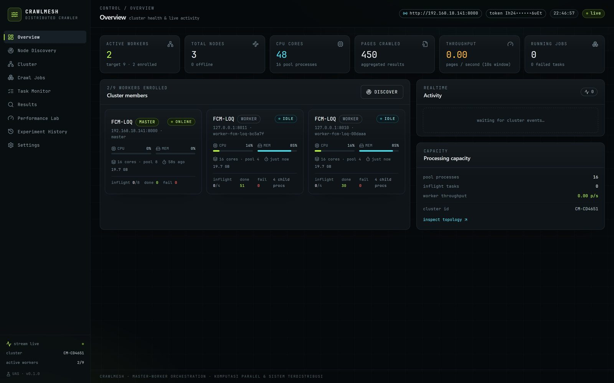

Komponen utama:

- **Active Workers** — jumlah worker yang siap menerima task (target 9).
- **Total Nodes** — Master + Worker yang dikenal cluster.
- **CPU Cores / pool** — total core dan total proses multiprocessing.
- **Pages Crawled / Throughput** — hasil agregat dan laju 10 detik terakhir.
- **Cluster members** — kartu setiap node: CPU, memory, pool, inflight, completed, failed.
- **Activity** — event realtime: node online/offline, job, task, eksperimen.
- **Processing capacity** — total pool, inflight, throughput worker, cluster id.

### 4.2 Node Discovery

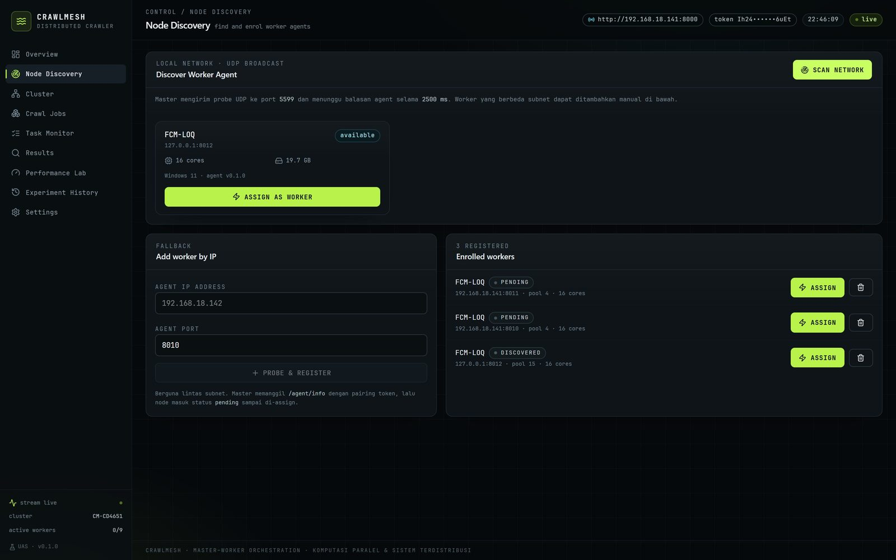

Cara kerja scan:

1. Master mengirim probe UDP ke port `5599` (dua kali, broadcast + loopback).
2. Setiap Worker Agent membalas dengan informasi hardware.
3. Agent yang belum terdaftar disimpan dengan status `discovered` agar bisa langsung di-assign.

Gunakan **Add worker by IP** bila agent berada di subnet lain, memakai port discovery berbeda,
atau diblokir oleh kebijakan jaringan.

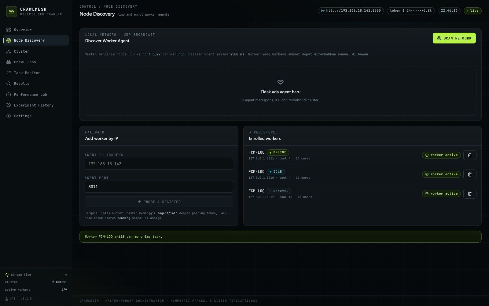

Setelah terdaftar, worker masuk daftar **Enrolled workers** dengan status `pending`. Tekan
**ASSIGN** untuk mengaktifkannya. Worker aktif akan berubah menjadi `idle`/`busy` sesuai beban.

### 4.3 Cluster dan topologi

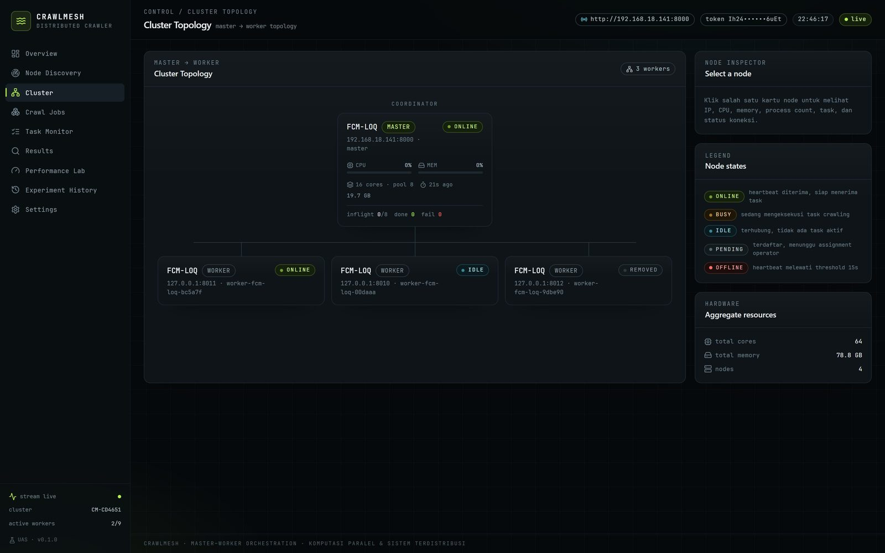

Setiap kartu node dapat diklik untuk membuka **Node Inspector**.

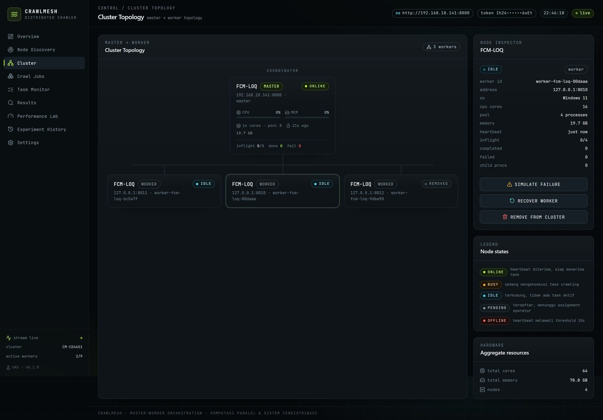

Aksi pada inspector:

- **SIMULATE FAILURE** — menandai node offline tanpa mematikan agent. Status bertahan sampai
  **RECOVER WORKER** ditekan, berguna untuk demonstrasi fault tolerance.
- **RECOVER WORKER** — mengembalikan node ke cluster.
- **REMOVE FROM CLUSTER** — mengeluarkan node; agent dapat ditemukan kembali lewat scan.

### 4.4 Crawl Jobs

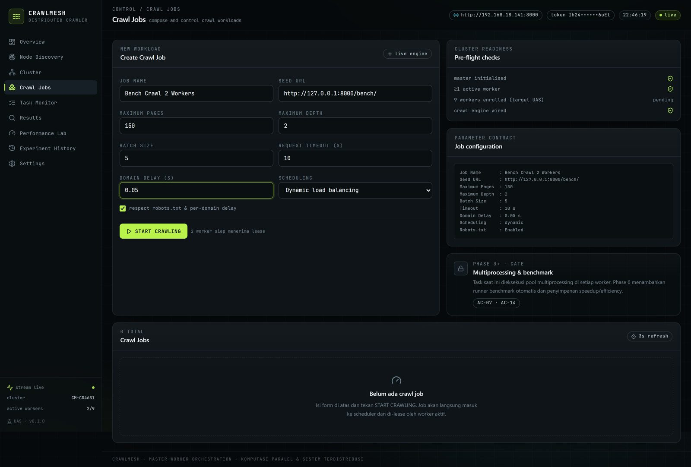

Parameter penting:

| Parameter | Fungsi |
|---|---|
| Job Name | Label pekerjaan |
| Seed URL | Titik awal crawling |
| Maximum Pages | Batas jumlah halaman unik yang dijadwalkan |
| Maximum Depth | Kedalaman link dari seed |
| Batch Size | Jumlah URL per task |
| Request Timeout | Batas waktu HTTP per URL |
| Domain Delay | Jeda antar request ke host yang sama |
| Robots.txt | Kepatuhan pada robots.txt |
| Scheduling | `dynamic` (beban) atau `static` (round-robin) |

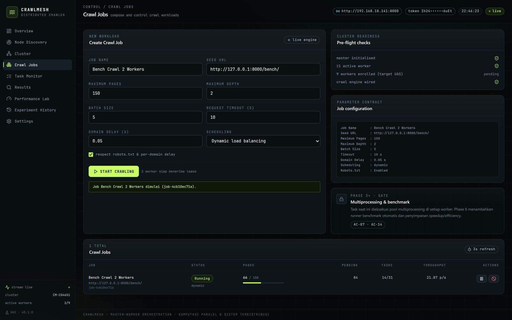

Tombol aksi:

- **Pause** — menghentikan leasing task baru; task yang sedang berjalan diselesaikan.
- **Resume** — melanjutkan job paused.
- **Cancel** — membatalkan job, task aktif, dan frontier yang belum diproses.

### 4.5 Task Monitor

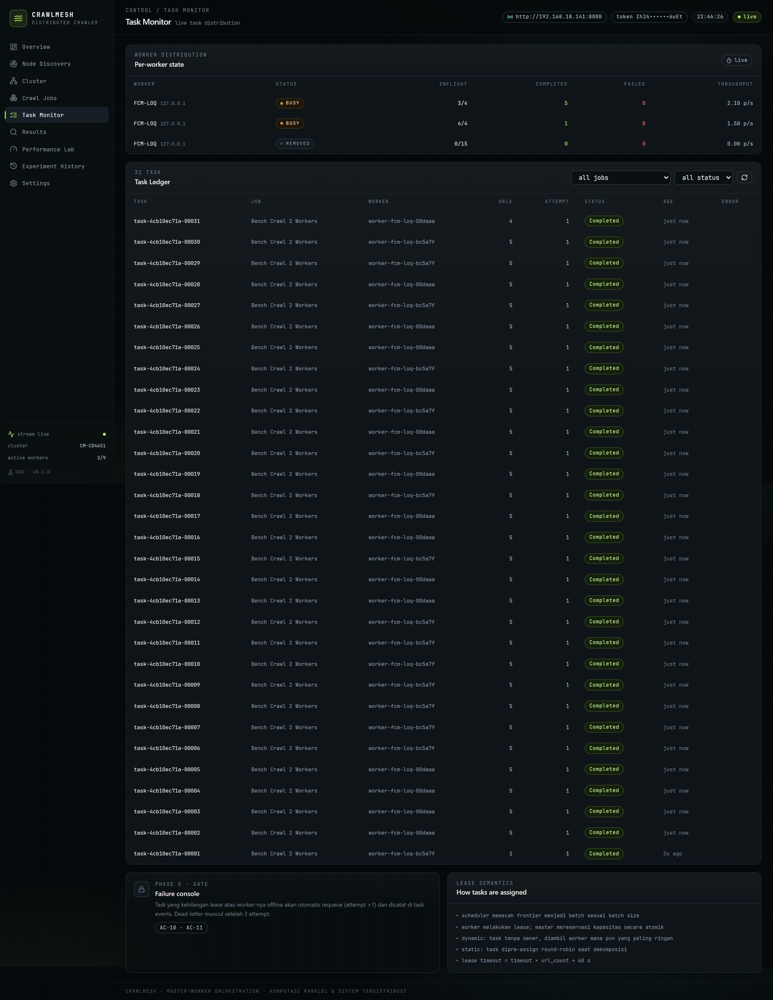

Halaman ini membuktikan pembagian kerja:

- Baris atas merangkum inflight, completed, failed, dan throughput per Worker.
- Tabel bawah menampilkan task per batch: jumlah URL, attempt, worker, umur, dan error.
- Filter job dan status membantu saat demo atau debugging.

### 4.6 Results

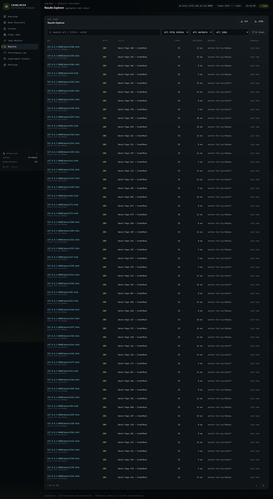

Fitur:

- Pencarian URL/judul, filter HTTP status, worker, dan job.
- Kolom status, judul, jumlah link, response time, worker, waktu crawl.
- Export CSV atau JSON melalui tombol di kanan atas.

Hasil disimpan idempoten dengan kunci `(job_id, url_hash)`. Jika task diulang karena kegagalan,
data tidak terduplikasi.

### 4.7 Performance Lab

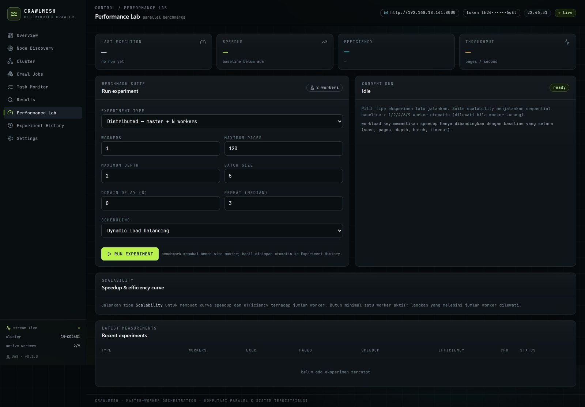

Tipe eksperimen:

| Tipe | Penjelasan |
|---|---|
| Sequential | Satu proses di Master, baseline pembanding |
| Local parallel | Process pool multiprocessing di Master |
| Distributed | Job dibagi ke N worker aktif |
| Scalability | Baseline + 1/2/4/6/9 worker secara otomatis |

Setiap run diulang sesuai **Repeat** dan diambil median. Timer dimulai setelah warm-up bench site
dan process pool.

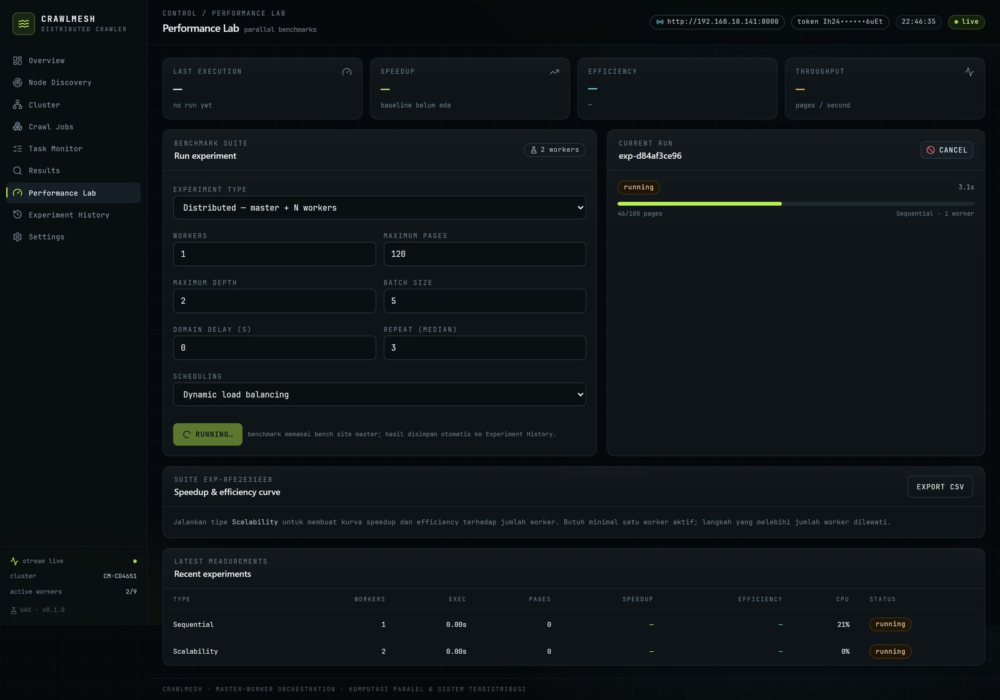

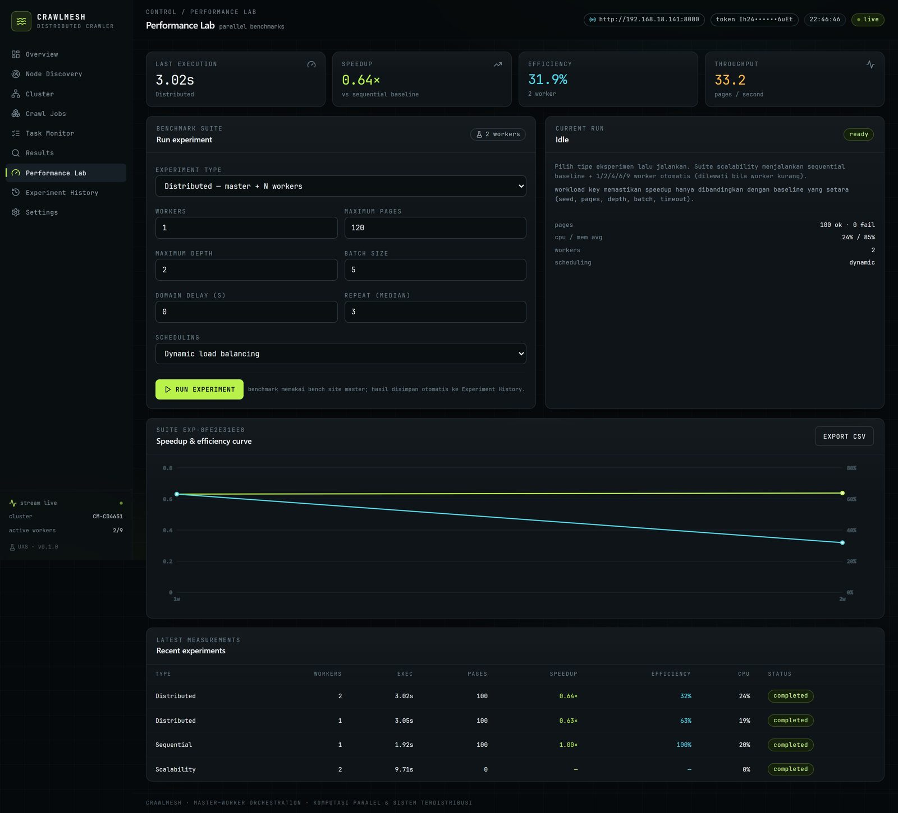

Interpretasi:

- **Speedup** = waktu baseline sequential ÷ waktu run ini.
- **Efficiency** = speedup ÷ jumlah worker × 100%.
- Nilai efficiency di atas 100% pada 1 worker berarti satu node menjalankan beberapa proses
  (multiprocessing). Catat sebagai temuan, bukan kesalahan.
- Pada mesin yang sama, distributed sering lebih lambat daripada sequential karena seluruh proses
  berebut CPU dan melewati loopback. Angka akan membaik ketika worker berada di komputer berbeda.

### 4.8 Experiment History

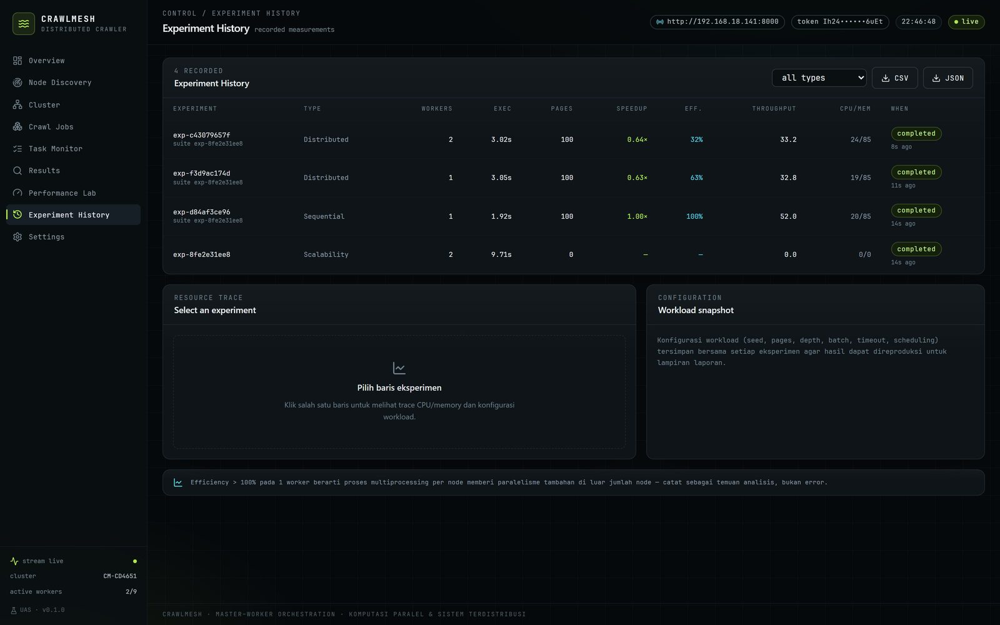

Klik salah satu baris untuk membuka detail.

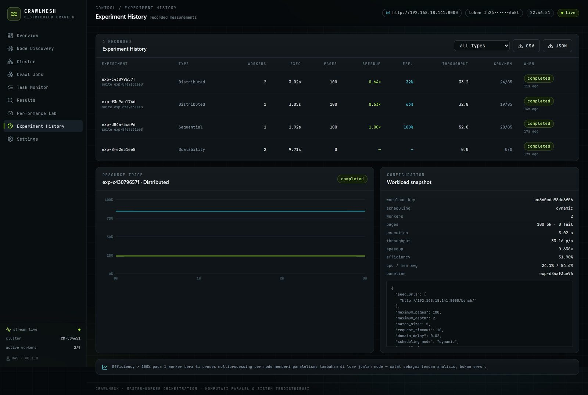

Detail menampilkan workload key, scheduling, jumlah worker, pages, execution time, throughput,
speedup, efficiency, baseline, dan konfigurasi lengkap. Export CSV/JSON tersedia untuk lampiran
laporan.

### 4.9 Settings

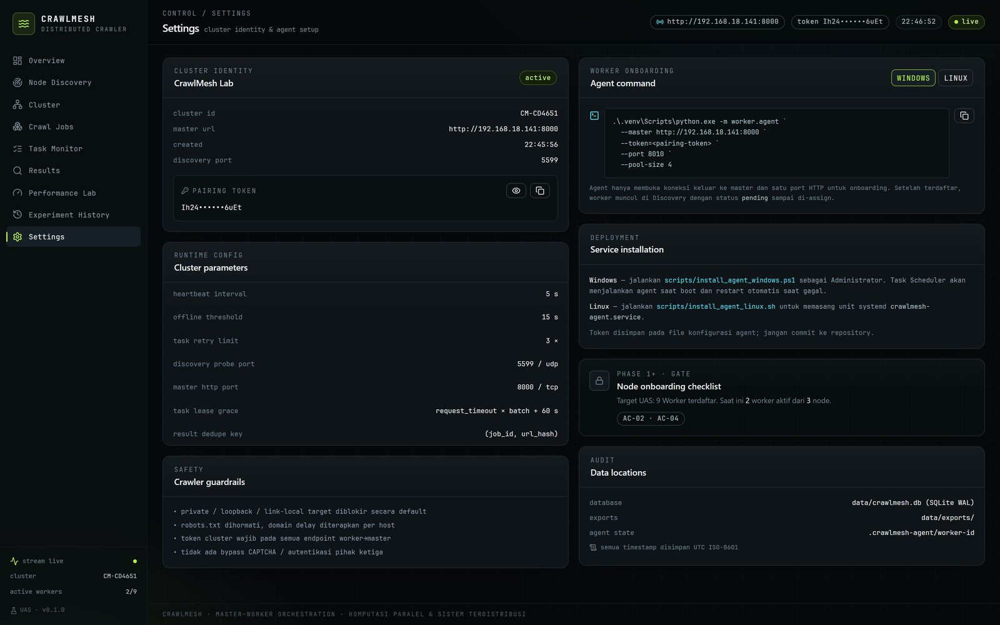

Halaman Settings berisi:

- Cluster ID, Master URL, pairing token (bisa ditampilkan/disalin).
- Perintah menjalankan agent untuk Windows dan Linux.
- Konfigurasi runtime: heartbeat 5 s, offline threshold 15 s, retry 3×, port discovery.
- Ringkasan guardrail keamanan crawler.

---

## 5. Menjalankan di perangkat lain

Bagian ini adalah prosedur untuk 1 Master dan 9 Worker pada 10 komputer fisik.

### 5.1 Topologi dan tabel node

| # | Hostname | IP | OS | Cores | RAM | Peran | Port agent |
|---|---|---|---|---|---|---|---|
| 1 |  |  |  |  |  | Master | 8000 |
| 2 |  |  |  |  |  | Worker | 8010 |
| 3 |  |  |  |  |  | Worker | 8010 |
| 4 |  |  |  |  |  | Worker | 8010 |
| 5 |  |  |  |  |  | Worker | 8010 |
| 6 |  |  |  |  |  | Worker | 8010 |
| 7 |  |  |  |  |  | Worker | 8010 |
| 8 |  |  |  |  |  | Worker | 8010 |
| 9 |  |  |  |  |  | Worker | 8010 |
| 10 |  |  |  |  |  | Worker | 8010 |

Semua mesin harus berada di LAN yang sama dan **AP isolation harus dimatikan** bila memakai Wi-Fi.

### 5.2 Port dan firewall

| Port | Proto | Sisi | Fungsi |
|---|---|---|---|
| 8000 | TCP | Master | GUI, REST, WebSocket |
| 8010 | TCP | Worker | `/agent/info` untuk onboarding dan health |
| 5599 | UDP | Worker | Discovery listener |

Windows Master (PowerShell sebagai Administrator):

```powershell
New-NetFirewallRule -DisplayName "CrawlMesh Master HTTP" -Direction Inbound -Protocol TCP -LocalPort 8000 -Action Allow -Profile Any
New-NetFirewallRule -DisplayName "CrawlMesh Discovery UDP" -Direction Inbound -Protocol UDP -LocalPort 5599 -Action Allow -Profile Any
```

Windows Worker:

```powershell
New-NetFirewallRule -DisplayName "CrawlMesh Agent HTTP" -Direction Inbound -Protocol TCP -LocalPort 8010 -Action Allow -Profile Any
New-NetFirewallRule -DisplayName "CrawlMesh Discovery UDP" -Direction Inbound -Protocol UDP -LocalPort 5599 -Action Allow -Profile Any
```

Linux Worker:

```bash
sudo ufw allow 8010/tcp
sudo ufw allow 5599/udp
```

Uji konektivitas dari worker:

```powershell
Test-NetConnection <MASTER_IP> -Port 8000
```

```bash
nc -vz <MASTER_IP> 8000
```

### 5.3 Menyiapkan Master

1. Salin repo ke komputer Master dan siapkan environment (bagian 2.2).
2. Jalankan `.\scripts\run_master.ps1`.
3. Buka GUI dan tekan **Initialize this node as master**.
4. Catat Cluster ID dan pairing token dari halaman **Settings**.
5. Pastikan Master memakai IP LAN, bukan loopback. Master URL yang benar terlihat pada chip di
   header, contoh `http://192.168.18.141:8000`.

Master hanya boleh satu. Menjalankan dua proses Master pada database yang sama akan menyebabkan
perebutan file SQLite.

### 5.4 Worker Windows

Uji manual:

```powershell
.\scripts\run_worker.ps1 -Master http://<MASTER_IP>:8000 -Token '<PAIRING_TOKEN>' -PoolSize 4
```

Pasang sebagai service (Task Scheduler, jalankan sebagai Administrator):

```powershell
.\scripts\install_agent_windows.ps1 -Master http://<MASTER_IP>:8000 -Token '<PAIRING_TOKEN>' -PoolSize 4
```

Perintah pemeriksaan:

```powershell
Get-ScheduledTask -TaskName "CrawlMesh Worker Agent" | Get-ScheduledTaskInfo
Stop-ScheduledTask -TaskName "CrawlMesh Worker Agent"
```

Worker akan dijalankan saat boot dan di-restart otomatis jika berhenti.

### 5.5 Worker Linux

```bash
python3 -m venv .venv
.venv/bin/pip install -r requirements.txt
sudo ./scripts/install_agent_linux.sh \
  --master http://<MASTER_IP>:8000 \
  --token '<PAIRING_TOKEN>' \
  --pool-size 4
```

Unit systemd akan mengatur restart otomatis:

```bash
systemctl status crawlmesh-agent
journalctl -u crawlmesh-agent -f
```

### 5.6 Distribusi token

Token bersifat rahasia cluster. Tiga cara aman:

1. Argumen `--token=<TOKEN>` (perhatikan tanda `=`, wajib bila token diawali `-`).
2. Variabel lingkungan `CRAWLMESH_TOKEN` lewat file `.env` di folder repo worker.
3. Script installer yang menyimpannya ke unit service/Task Scheduler.

Jangan menaruh token pada repository publik atau screenshot yang dibagikan.

### 5.7 Mendaftarkan worker ke cluster

**Cara A — scan jaringan (disarankan bila satu subnet):**

1. Pastikan agent jalan dan menunjuk Master yang benar.
2. Buka **Node Discovery** → **SCAN NETWORK**.
3. Tekan **ASSIGN AS WORKER**.

**Cara B — add by IP (beda subnet / discovery diblokir):**

1. Buka **Node Discovery** → isi **Agent IP Address** dan **Agent Port** (default 8010).
2. Tekan **PROBE & REGISTER**. Master memanggil `/agent/info` dengan pairing token.
3. Node masuk sebagai `pending`; tekan **ASSIGN** pada daftar enrolled.

**Cara C — agent otomatis mendaftar:**

Agent dengan Master URL dan token yang benar akan mendaftar sendiri sebagai `pending` saat
startup. Cukup tekan **ASSIGN** di daftar enrolled. Status `pending` berarti agent hidup tetapi
belum diizinkan menerima task.

### 5.8 Membuka GUI dari perangkat lain

GUI tersedia dari komputer mana pun di LAN:

```
http://<MASTER_IP>:8000
```

Tidak perlu memasang Node.js di perangkat operator. Hanya Master yang menyajikan frontend.
Disarankan memakai browser modern (Edge/Chrome/Firefox) dan menambahkan bookmark ke halaman
Overview.

### 5.9 Beberapa agent pada satu komputer

Untuk demo tanpa 10 mesin fisik, beberapa agent dapat dijalankan pada satu host. Setiap instance
wajib memakai kombinasi unik:

```powershell
.\.venv\Scripts\python.exe -m worker.agent `
  --master http://127.0.0.1:8000 `
  --token=<TOKEN> `
  --port 8010 --discovery-port 5600 `
  --pool-size 4 --state-dir data/agent-8010
```

Instance kedua:

```powershell
.\.venv\Scripts\python.exe -m worker.agent `
  --master http://127.0.0.1:8000 `
  --token=<TOKEN> `
  --port 8011 --discovery-port 5601 `
  --pool-size 4 --state-dir data/agent-8011
```

`--state-dir` memisahkan identitas worker; tanpa itu kedua agent berbagi Worker ID yang sama.
Hanya satu instance yang dapat memakai port discovery default `5599`, jadi daftarkan instance
lain lewat **Add worker by IP**. Catat pada laporan bahwa node tersebut bukan mesin fisik terpisah.

### 5.10 Upgrade dan reset

Upgrade kode di semua mesin:

```powershell
git pull
.\.venv\Scripts\python.exe -m pip install -r requirements.txt
cd web; npm install; npm run build; cd ..
```

Lalu restart Master dan setiap agent (atau service). Build GUI cukup dilakukan di Master.

Reset cluster (menghapus job, hasil, eksperimen, dan token):

```powershell
# hentikan master dan seluruh agent terlebih dahulu
Remove-Item data\crawlmesh.db*
.\scripts\run_master.ps1
```

Setelah reset, token baru dibuat saat inisialisasi. Perbarui token di seluruh agent.

### 5.11 Verifikasi cluster

| Pemeriksaan | Cara | Harapan |
|---|---|---|
| Master hidup | `GET /api/health` | `status: ok`, `initialized: true` |
| Worker terdaftar | Overview | 9 worker aktif |
| Heartbeat | Cluster | `last heartbeat` baru |
| Multiprocessing | kartu node | `pool > 1`, `child procs > 0` saat crawl |
| Distribusi task | Task Monitor | beberapa worker menerima lease |
| Kegagalan | matikan satu agent | status offline ≤ 15 s, task requeue |
| Pemulihan | hidupkan agent | worker kembali `idle` |

---

## 6. Benchmark 1, 2, 4, 6, dan 9 worker

Gunakan **Performance Lab** dengan parameter identik untuk semua run:

| Parameter | Nilai |
|---|---|
| Seed | `http://<MASTER_IP>:8000/bench/` |
| Maximum pages | 120 |
| Maximum depth | 2 |
| Batch size | 5 |
| Request timeout | 10 s |
| Domain delay | 0 |
| Repeat | 3 |
| Scheduling | dynamic |

Langkah:

1. Pastikan hanya N worker yang aktif (gunakan **Remove** pada worker berlebih atau jalankan
   suite scalability yang otomatis memilih N worker aktif).
2. Jalankan tipe **Scalability** untuk baseline + 1/2/4/6/9 sekaligus, atau jalankan
   **Distributed** dengan jumlah worker tertentu.
3. Tunggu hingga status `completed`.
4. Buka **Experiment History**, export CSV.
5. Catat juga CPU/MEM rata-rata dan throughput.

Data yang perlu masuk laporan:

| Experiment | Workers | Exec (s) | Speedup | Efficiency | Throughput |
|---|---|---|---|---|---|
| Sequential | 1 proc |  | 1.00 | 100% |  |
| Local parallel | 4 proc |  |  |  |  |
| Distributed | 1 |  |  |  |  |
| Distributed | 2 |  |  |  |  |
| Distributed | 4 |  |  |  |  |
| Distributed | 6 |  |  |  |  |
| Distributed | 9 |  |  |  |  |

Protokol lengkap ada pada lampiran **Protokol Benchmark**.

---

## 7. Uji fault tolerance

1. Jalankan crawl job dengan beberapa worker aktif.
2. Saat job berjalan, buka **Cluster** → pilih satu worker → **SIMULATE FAILURE**.
3. Amati:
   - status worker menjadi `offline`;
   - Activity menampilkan kegagalan;
   - task milik worker tersebut kembali ke antrean (attempt bertambah);
   - job tetap berjalan dan selesai oleh worker lain.
4. Tekan **RECOVER WORKER** untuk mengembalikan node.

Untuk pengujian realistis, hentikan service agent atau putuskan jaringan. Master akan mendeteksi
setelah 15 detik tanpa heartbeat.

Catat jumlah task terdampak, task yang di-requeue, worker pengganti, dan waktu pemulihan.

---

## 8. Troubleshooting

| Gejala | Penyebab umum | Solusi |
|---|---|---|
| Scan menemukan 0 node | agent mati, token salah, UDP diblokir | cek `/agent/health`, samakan token, buka UDP 5599 |
| Worker langsung `offline` | agent tidak bisa mencapai Master | uji TCP 8000, cek IP Master di argumen |
| `401 Pairing token tidak valid` | token berbeda | salin ulang dari Settings |
| `409 Master belum diinisialisasi` | cluster kosong | tekan Initialize |
| Worker `pending` terus | belum di-assign | tekan ASSIGN |
| GPU 503 / halaman kosong | build frontend belum ada | `cd web && npm run build`, restart Master |
| Dua agent saling menimpa | Worker ID sama | tambahkan `--state-dir` berbeda |
| Port 5599 dipakai proses lain | agent lama masih hidup | hentikan proses agent sebelumnya |
| Status berubah-ubah online/offline | jaringan tidak stabil | cek Wi-Fi, switch, atau naikkan interval heartbeat |
| Speedup < 1 | worker masih di mesin yang sama | jalankan worker di mesin terpisah dan ulangi |
| Eksperimen gagal "tidak menghasilkan halaman" | job selesai sebelum worker siap | pastikan worker aktif, ulangi run |

Pada Windows, proses `python.exe` dapat memiliki proses anak `python3.15.exe`. Saat membersihkan
agent, hentikan keduanya.

---

## 9. Checklist hari-H

- [ ] Tabel node terisi (hostname/IP/OS/core/RAM)
- [ ] Firewall 8000/TCP, 8010/TCP, 5599/UDP terbuka
- [ ] Master diinisialisasi dan token dibagikan
- [ ] 9 agent berjalan sebagai service
- [ ] 9 worker berstatus aktif
- [ ] Crawl bench berhasil dan hasil terekspor
- [ ] Simulasi kegagalan + recovery diperagakan
- [ ] Suite scalability dijalankan
- [ ] Screenshot dan rekaman demo disiapkan
- [ ] Laporan BAB I–IV diisi dari data aktual

---

## 10. Batasan dan keamanan

- Satu Master per cluster; tidak ada high availability.
- Sistem memblokir target private/loopback secara default, kecuali bench site Master.
- Robots.txt dan domain delay dihormati; tidak ada bypass CAPTCHA atau autentikasi.
- Token cluster wajib pada seluruh endpoint worker.
- SQLite membatasi throughput tulis; cukup untuk skala UAS, bukan produksi.
- Benchmark pada satu mesin mengukur overhead koordinasi, bukan keunggulan jaringan.

