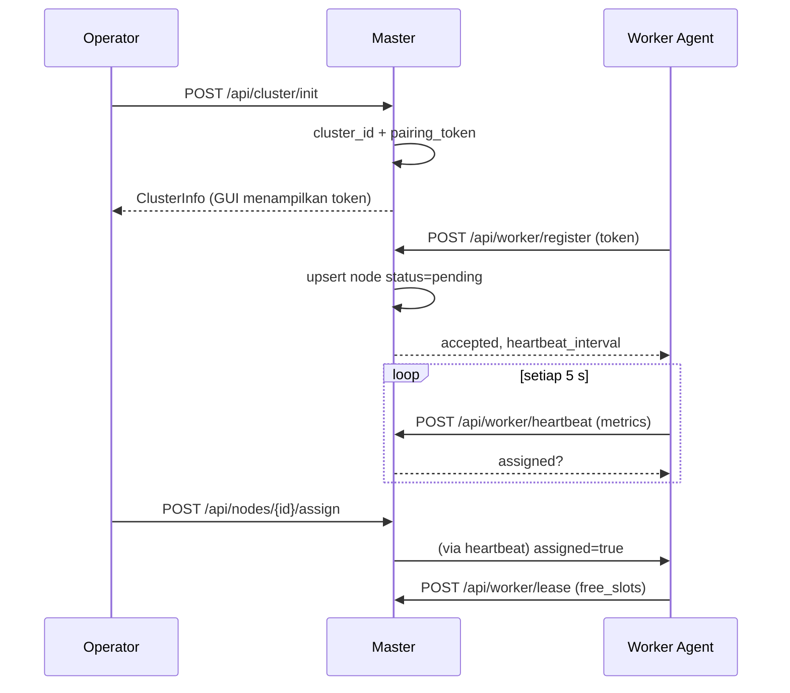
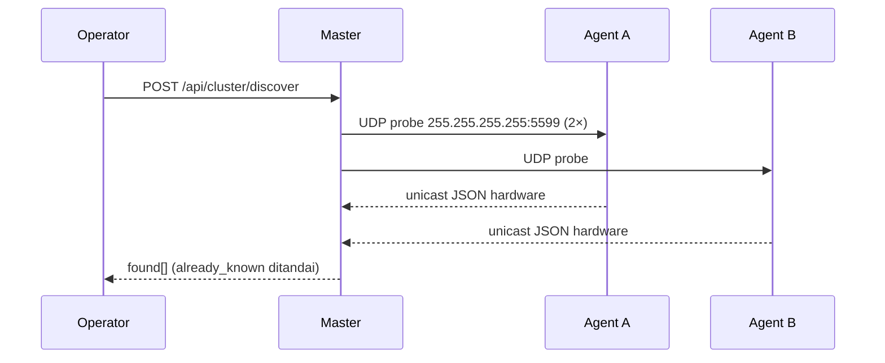
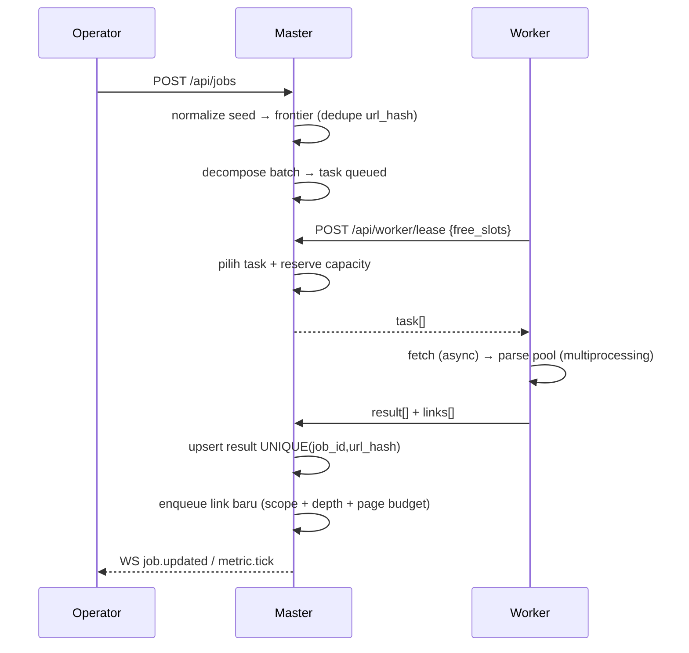
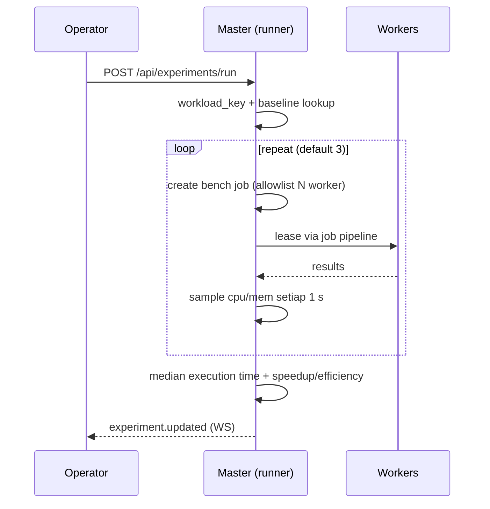

# CrawlMesh — Technical Design Document

Versi 0.3 · Phase 0–6 terimplementasi · dokumen hidup sampai Phase 7.

---

## 1. Tujuan sistem

Membuktikan komputasi paralel dan terdistribusi dengan kasus web crawler:

1. satu pekerjaan crawl dipecah menjadi task independen;
2. task dieksekusi oleh banyak Worker melalui jaringan;
3. setiap Worker memakai multiprocessing untuk parsing/ekstraksi;
4. Master mendistribusikan task berdasarkan kondisi resource aktual;
5. kegagalan satu Worker tidak menghilangkan pekerjaan;
6. performa dapat diukur (speedup, efficiency, throughput, recovery time);
7. semua kendali dan pengamatan tersedia lewat GUI.

---

## 2. Komponen runtime

| Komponen | Proses | Tanggung jawab |
|----------|--------|----------------|
| Master | 1 proses uvicorn | REST API, WS hub, scheduler, fault detector, SQLite |
| Worker Agent | 1 proses per mesin | register, heartbeat, lease, fetch, process pool, metrics |
| Web GUI | browser | orkestrasi cluster, crawl, monitoring, benchmark |
| Bench site | route di Master | halaman statis deterministik untuk benchmark |

```
web/ React ──HTTP/WS──> master/app (FastAPI)
                          ├─ api/*            kontrak HTTP
                          ├─ domain/*         logika (cluster, discovery, frontier, …)
                          ├─ db/              SQLite + schema + migrasi aditif
                          └─ static/          hasil build React

worker/agent.py ──HTTP──> master (outbound only)
  ├─ heartbeat loop  (5 s)
  ├─ lease loop      (1 s, saat assigned & ada slot)
  ├─ discovery UDP   (port 5599)
  └─ process pool    (Phase 3)
```

### Modul master

| Modul | Isi |
|-------|-----|
| `api/cluster.py` | init, overview, discover |
| `api/nodes.py` | list, assign, remove, simulate-failure, manual add |
| `api/worker.py` | register, heartbeat, lease/result/fail |
| `api/ws.py` | snapshot + event stream |
| `domain/cluster.py` | node registry, status transition, stale detector |
| `domain/discovery.py` | probe UDP + parsing balasan |
| `domain/hub.py` | fan-out WS, drop slow client |
| `db/database.py` | koneksi, lock tulis, migrasi aditif |

---

## 3. Alur utama

### 3.1 Bootstrap cluster



Rasional outbound-only: lihat ADR 0002.

### 3.2 Discovery



Agent membalas dari socket yang sama dengan listener. Di Windows, `SIO_UDP_CONNRESET` dimatikan
agar ICMP port-unreachable tidak mematikan listener (ADR 0003).

### 3.3 Crawl



### 3.4 Fault tolerance

- Heartbeat interval 5 s, offline threshold 15 s, scanner 2 s.
- Task lease deadline = `request_timeout × batch_size + 60 s`.
- Worker offline → task `leased/running` miliknya dikembalikan ke queue (`attempt+1`).
- `attempt > 3` → dead-letter (`tasks.status='dead'`), dicatat di `task_events`.
- `failure_events` menyimpan detected_at, affected, requeued, replacement, recovered_at.
- Simulasi kegagalan lewat GUI memakai flag `simulated_offline` sehingga status tetap `offline`
  walau agent masih mengirim heartbeat.

### 3.5 Bench site

Master menyajikan `GET /bench/` dan `GET /bench/{n}.html` (300 halaman, ±120 KB, 32 link acak
deterministik per halaman). Tujuannya:

- workload identik untuk semua konfigurasi eksperimen;
- latency jaringan dan ukuran konten konsisten;
- parsing cukup berat agar multiprocessing terukur;
- tidak butuh internet saat demo;
- seed privat `/bench` otomatis diizinkan menembus SSRF guard (host master saja).

### 3.6 Experiment runner



Aturan metodologi:

- `workload_key = hash(seed, pages, depth, batch, timeout, bench version)`; speedup hanya dihitung
  terhadap baseline sequential dengan key yang sama.
- `repeat` run diulang lalu diambil median untuk menekan variansi cache/jaringan.
- Warm-up pool/parse/koneksi sebelum timer dimulai, agar yang diukur adalah pekerjaan crawl.
- Sequential mode berjalan di proses Master dengan concurrency 1 dan parsing inline.
- Local parallel memakai ProcessPoolExecutor di Master (N proses).
- Distributed memakai worker aktif dengan allowlist per job; kapasitas tiap worker tetap
  dihormati oleh lease.
- Efficiency = (speedup / jumlah worker) × 100%; nilai >100% pada N=1 menandakan kontribusi
  multiprocessing per node dan harus dijelaskan di analisis, bukan dianggap error.
- Scalability suite menjalankan baseline sequential (jika belum ada) lalu N = 1, 2, 4, 6, 9;
  langkah yang melebihi jumlah worker aktif dilewati dan dicatat.

---

## 4. Model data

| Tabel | Kunci/indeks penting | Fungsi |
|-------|----------------------|--------|
| `cluster` | id=1 | identitas + token |
| `nodes` | worker_id | registry + sample resource terakhir |
| `jobs` | job_id, status | konfigurasi crawl + agregat progres |
| `frontier_urls` | `UNIQUE(job_id,url_hash)` | antrean URL + dedupe |
| `tasks` | task_id, `(job_id,status)` | batch kerja + lease + attempt |
| `results` | `UNIQUE(job_id,url_hash)` | hasil idempoten |
| `worker_metrics` | `(worker_id, recorded_at)` | time series resource |
| `task_events` | `(task_id, created_at)` | audit transisi task |
| `failure_events` | worker_id, detected_at | laporan recovery |
| `experiments` + `experiment_samples` | experiment_id | hasil benchmark |

Semua timestamp UTC ISO-8601. Penulisan diserialisasi oleh satu lock asyncio.

---

## 5. Scheduling & load balancing (Phase 4)

```
eligible = node.status ∈ {online,idle,busy} ∧ heartbeat < 15 s
           ∧ inflight < capacity ∧ cpu_usage < 90
load(n)  = 0.4·cpu + 0.3·mem + 0.3·(inflight / capacity)
dynamic  = argmin(load) ; tie → inflight terkecil
static   = round-robin dengan kuota floor(total_tasks / active_workers)
lease    = min(free_slots, capacity − inflight), reservasi atomik
```

Metrik yang dilaporkan Worker: cpu, mem, active/child process, inflight, throughput,
avg processing time. Master menyimpan sampel ke `worker_metrics` untuk chart.

---

## 6. Multiprocessing (terimplementasi)

- Fetch memakai `httpx.AsyncClient` + `asyncio.Semaphore(fetch_concurrency)` — I/O bound.
- Parsing/ekstraksi/hash/normalisasi dikirim ke `ProcessPoolExecutor` (`spawn`) — CPU bound.
- Parser memakai `html.parser` stdlib (tanpa dependency) dan menghasilkan title, text,
  links ternormalisasi, serta SHA-256 konten.
- Pool size = `min(cores − 1, config)`, minimal 1; capacity = jumlah task paralel.
- Bukti AC-07: `pool_size` dan `child_processes` (psutil) tampil di GUI.

---

## 6b. Lifecycle job

1. `POST /api/jobs` menormalkan seed, menerapkan scope/budget, dan mengisi frontier.
2. Scheduler tick (1 s) memecah frontier menjadi task sesuai `batch_size`; mode static
   mempre-assign worker round-robin.
3. Worker melaksanakan lease → fetch → parse pool → POST result.
4. Master menulis result idempoten, memasukkan link baru (depth + 1), menandai frontier
   `finished`, lalu mengecek apakah job selesai.
5. Job selesai bila tidak ada frontier `queued/scheduled` dan tidak ada task aktif.
6. Pause menghentikan leasing; cancel menandai task/frontier aktif sebagai cancelled.

---

## 7. Keamanan

- Token cluster wajib untuk semua endpoint worker; perbandingan `secrets.compare_digest`.
- Endpoint admin belum ber-autentikasi (demo LAN); sebelum deploy nyata perlu session/token GUI.
- SSRF guard: blokir IP private/loopback/link-local/CGNAT, `localhost`, `*.local`; fetch layer
  wajib re-check hasil DNS resolution.
- Robots.txt dihormati, domain delay per host, User-Agent jelas.
- Tidak ada bypass autentikasi/CAPTCHA.

---

## 8. Observability

| Sumber | Isi |
|--------|-----|
| `GET /api/cluster/overview` | snapshot dashboard |
| WebSocket `/ws` | perubahan node, job, metrik, failure |
| `worker_metrics` | time series CPU/memory/throughput |
| `task_events` | audit per task |
| `failure_events` | deteksi kegagalan + recovery |
| `data/*.log` | log master/worker saat mode script |

---

## 9. Rencana pengujian

| Uji | Konfigurasi | Output |
|-----|-------------|--------|
| Sequential | 1 proses, bench site | baseline time, throughput |
| Local parallel | 1 mesin, pool N | speedup vs sequential |
| Distributed | 1 master + N worker | time, distribusi, resource |
| Load balancing | static vs dynamic | rasio distribusi, waktu |
| Fault tolerance | kill worker saat running | recovery time, task requeue |
| Scalability | 1/2/4/6/9 worker | speedup & efficiency curve |

Workload key = hash(seed + max_pages + max_depth + batch + timeout + bench version) agar semua
perbandingan memakai beban yang sama.

---

## 10. Risiko teknis aktif

| Risiko | Mitigasi |
|--------|----------|
| Broadcast UDP diblokir | add-by-IP + token |
| Beberapa agent satu host | `--discovery-port` unik per instance |
| Firewall Windows | izinkan 8000/TCP (master) dan 5599/UDP, 8010/TCP (worker) |
| Clock skew | semua durasi dihitung dari timestamp Master |
| Bench site membebani Master | halaman statis pre-generated, bukan generator dinamis |
| SQLite write contention | satu koneksi + lock, batch kecil |
