# CrawlMesh — Arsitektur Sistem

**Versi dokumen:** 1.0 · **Status:** implemented (Phase 0–6) · **Terakhir diperbarui:** 2026-11-19

Dokumen ini memetakan arsitektur CrawlMesh sebagaimana **benar-benar ada di repo**, bukan hanya
rancangan. Setiap modul, endpoint, tabel, dan konstanta waktu merujuk pada file sumber. Fitur yang
belum berjalan ditandai **planned** pada [bagian 20](#20-status-implementasi).

Diagram tersedia dalam dua bentuk:

- **Mermaid** — dirender oleh GitHub, GitLab, VS Code (dengan ekstensi), dan Obsidian.
- **ASCII** — fallback yang tetap terbaca di editor tanpa plugin dan dipakai pada ekspor HTML cetak.

---

## 1. Tujuan dan ruang lingkup

CrawlMesh membuktikan tiga hal sekaligus melalui satu aplikasi:

1. **Paralelisme** — setiap Worker memakai `ProcessPoolExecutor` untuk parsing/ekstraksi HTML.
2. **Distribusi** — satu Master membagi task crawling ke banyak Worker melalui jaringan.
3. **Orkestrasi GUI-first** — discovery, registrasi, crawling, pemantauan, simulasi kegagalan, dan
   benchmark dijalankan dari browser tanpa CLI berulang.

### In scope

- Cluster Master–Worker hingga 1 + 9 node.
- Web crawler dengan frontier, dedupe, scope domain, robots.txt, dan domain delay.
- Dynamic load balancing dan static scheduling sebagai pembanding.
- Fault tolerance: heartbeat, offline detection, lease timeout, retry, dead-letter.
- Benchmark otomatis: sequential, local parallel, distributed, scalability.
- GUI monitoring realtime dan export hasil.

### Non-goals

- Search engine skala internet, distributed storage besar, multi-master/HA.
- Bypass CAPTCHA/autentikasi, browser automation, scraping akun pihak ketiga.
- Auto-provisioning cloud.

---

## 2. Konteks sistem (C4 Level 1)

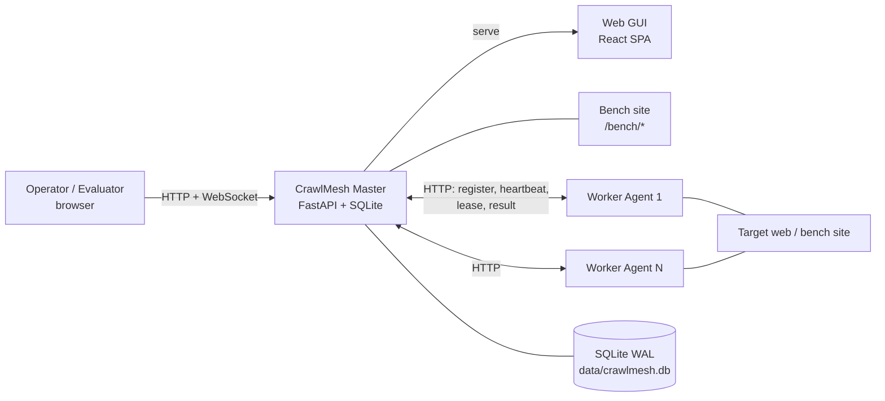

```
      Operator (browser)
            │  HTTP + WS
            ▼
   ┌──────────────────────┐        ┌───────────────┐
   │   Master (FastAPI)   │◄──────►│ SQLite (WAL)  │
   │  API · scheduler ·   │        └───────────────┘
   │  WS hub · bench site │
   └───────┬──────────────┘
           │ HTTP (outbound dari worker)
     ┌─────┴─────┬───────────┐
     ▼           ▼           ▼
  Worker 1    Worker 2 …  Worker N
  (agent +    (agent +    (agent +
  process     process     process
  pool)       pool)       pool)
```

Karakter kunci: Worker **tidak** membuka port untuk menerima task. Semua dispatch memakai model
**pull/lease**, sehingga Master tidak perlu route ke Worker (aman terhadap NAT/firewall).

---

## 3. Container view (C4 Level 2)

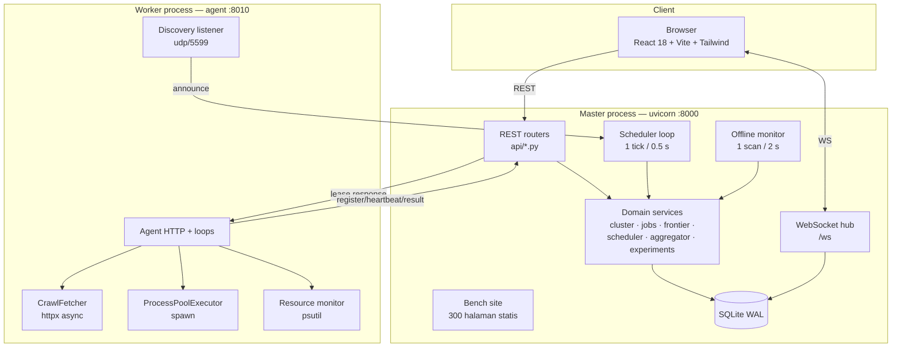

```
Browser ──REST/WS──► Master
                       ├─ api/          kontrak HTTP
                       ├─ domain/       logika orkestrasi
                       ├─ db/           SQLite + migrasi
                       ├─ static/       hasil build React
                       └─ bench site    workload benchmark
Worker ──HTTP keluar──► Master
  ├─ heartbeat 5 s
  ├─ lease 0.25 s (saat idle)
  ├─ fetch async + parse pool
  └─ UDP discovery listener
```

| Container | Teknologi | Port | Tanggung jawab |
|---|---|---|---|
| Web GUI | React 18, TypeScript, Vite, Tailwind v4, TanStack Query, Recharts | — (di-serve Master) | Kendali cluster, monitoring, benchmark |
| Master | Python 3.13, FastAPI, uvicorn, aiosqlite | 8000/TCP | API, scheduler, fault detector, WS, bench site |
| Worker Agent | Python 3.13, FastAPI, httpx, psutil | 8010/TCP | Registrasi, heartbeat, fetch, parsing, metrik |
| Discovery | UDP broadcast | 5599/UDP | Penemuan agent di LAN |
| Storage | SQLite WAL | file | State cluster, frontier, task, hasil, eksperimen |
| Bench site | FastAPI route | 8000/TCP | Halaman statis deterministik untuk benchmark |

---

## 4. Peta repo

```
crawlmesh/
├─ shared/                      kontrak yang dipakai Master dan Worker
│  ├─ models.py                 Pydantic: node, job, task, lease, result, metrics, enum status
│  ├─ urlnorm.py                normalize_url, url_hash, in_scope, is_safe_public_url
│  └─ netinfo.py                local_ip (filter adapter virtual), disable_udp_connreset (Windows)
│
├─ master/
│  ├─ app/main.py               lifespan, CORS, router mounting, SPA fallback,
│  │                             _scheduler_loop (0.5 s), _offline_monitor (2 s)
│  ├─ app/core/
│  │  ├─ config.py              Settings (env CRAWLMESH_*), path DB/static
│  │  └─ net.py                 re-export local_ip
│  ├─ app/db/
│  │  ├─ schema.sql             12 tabel + index
│  │  └─ database.py            Database (one connection, write lock), migrasi aditif
│  ├─ app/domain/
│  │  ├─ cluster.py             init, register, heartbeat, assign/remove, stale detector, overview
│  │  ├─ discovery.py           probe UDP + parsing balasan
│  │  ├─ jobs.py                create/list/status, workload_key, complete_if_done
│  │  ├─ frontier.py            enqueue (normalize/scope/budget/dedupe), backlog
│  │  ├─ scheduler.py           decompose, lease, requeue, finish_task, tick
│  │  ├─ aggregator.py          ingest_results (idempoten), fail_task
│  │  ├─ experiments.py         runner benchmark, sampling, baseline, median
│  │  └─ hub.py                 EventHub fan-out WebSocket
│  ├─ app/api/
│  │  ├─ health.py  cluster.py  nodes.py  jobs.py
│  │  ├─ worker.py              register/heartbeat/lease/result/fail
│  │  ├─ experiments.py         run/list/detail/cancel/export
│  │  ├─ ws.py                  snapshot + ping/pong
│  │  └─ bench.py               /bench index, pages, robots, warm-up
│  └─ app/static/               hasil `npm run build` (di-commit agar deploy mudah)
│
├─ worker/
│  ├─ agent.py                  WorkerAgent + FastAPI agent + CLI argparse
│  ├─ config.py                 AgentConfig (env/CLI), worker id stabil, pool size
│  ├─ crawler.py                CrawlFetcher: SSRF, robots cache, domain gate, HTTP
│  ├─ parser_pool.py            parse_document (HTMLParser) — entry point process pool
│  ├─ monitor.py                ResourceMonitor (cpu, mem, child process, throughput)
│  └─ discovery.py              UDP listener + balasan announce
│
├─ web/
│  ├─ src/pages/                Overview, Discovery, Topology, Jobs, Tasks, Results,
│  │                             Performance, Experiments, Settings
│  ├─ src/components/           AppShell, Sidebar, NodeCard, StatusPill, Panel, StatTile…
│  ├─ src/lib/                  api client, types, useLiveCluster (WS + query cache)
│  └─ vite.config.ts            proxy dev :5173 → :8000, build ke master/app/static
│
├─ scripts/
│  ├─ run_master.ps1            jalankan Master
│  ├─ run_worker.ps1            jalankan agent (token aman untuk karakter '-')
│  ├─ install_agent_windows.ps1 Task Scheduler service
│  ├─ install_agent_linux.sh    systemd unit
│  └─ dev.ps1                   Master --reload + Vite dev server
│
├─ tools/guides/                capture.py (seed + screenshot), build_html.py (panduan A4)
├─ tests/                       16 test: urlnorm, cluster lifecycle, crawl engine, budget
├─ docs/                        GUIDE, TDD, API, RUNBOOK, BENCHMARK, architecture, adr/
└─ data/                        runtime (gitignored): crawlmesh.db, log, export, state agent
```

---

## 5. Komponen Master

### 5.1 Entry point dan background loop

`master/app/main.py`

| Bagian | Fungsi |
|---|---|
| `lifespan` | buka DB, buat `EventHub`, start `_offline_monitor` + `_scheduler_loop`, tutup rapi |
| `_offline_monitor` | setiap 2 s panggil `mark_stale_offline`; worker yang hilang di-requeue + event `worker.failed` |
| `_scheduler_loop` | setiap 0.5 s `scheduler.tick`: decompose, requeue lease kedaluwarsa, auto-complete job |
| `_mount_spa` | fallback route → `index.html`; file statis disajikan langsung |
| middleware | CORS untuk dev Vite (`:5173`) |

### 5.2 API router

| Router | File | Tanggung jawab |
|---|---|---|
| System | `api/health.py` | status, versi, cluster id, path DB |
| Cluster | `api/cluster.py` | init idempoten, overview, discovery + persist node `discovered` |
| Nodes | `api/nodes.py` | list/detail, assign, remove, simulate-failure, recover, add-by-IP |
| Jobs | `api/jobs.py` | create/list/detail, pause/resume/cancel, tasks, results, export, frontier, metrics |
| Worker | `api/worker.py` | register, heartbeat, lease, result, fail (semua token-protected) |
| Experiments | `api/experiments.py` | run, busy, list, detail (+samples), cancel, export |
| WebSocket | `api/ws.py` | snapshot saat connect, ping/pong |
| Bench | `api/bench.py` | index, 300 halaman, robots.txt, warm-up render |

### 5.3 Domain services

| Modul | Fungsi kunci | Catatan desain |
|---|---|---|
| `cluster.py` | `init_cluster`, `register_worker`, `heartbeat`, `assign_worker`, `remove_worker`, `mark_stale_offline`, `overview` | status node dihitung ulang dari heartbeat; `simulated_offline` menahan status |
| `discovery.py` | `scan_network` → `_scan_sync` | probe dikirim dari socket yang sama dengan penerima balasan |
| `jobs.py` | `create_job`, `set_status`, `complete_if_done`, `workload_key` | job dibuat `pending`, seed di-enqueue, baru `running` (menutup race auto-complete) |
| `frontier.py` | `enqueue_urls` | lock global enqueue; budget `maximum_pages` dihitung atomik |
| `scheduler.py` | `decompose_job`, `lease_tasks`, `requeue_expired`, `finish_task`, `tick` | lease di bawah `asyncio.Lock`; reservasi `inflight` |
| `aggregator.py` | `ingest_results`, `fail_task` | insert hasil `ON CONFLICT DO NOTHING`; link masuk frontier depth+1 |
| `experiments.py` | `start`, `_run_single`, `_run_local`, `_run_scalability`*, `_sample` | satu runner aktif; median repeat; warm-up di luar timer |
| `hub.py` | `EventHub.broadcast` | client lambat di-drop, tidak memblokir orchestrator |

\* Nama aktual `_run_scalability` berada di modul yang sama.

### 5.4 Akses database

`db/database.py`

- Satu koneksi `aiosqlite` per proses Master, `row_factory` dict.
- PRAGMA: `journal_mode=WAL`, `foreign_keys=ON`, `busy_timeout=5000`, `synchronous=NORMAL`.
- `_write_lock` menyerialkan semua penulisan; `write_many` membungkus batch dalam satu commit.
- `_migrate` menambah kolom baru secara aditif berdasarkan `PRAGMA table_info` — pola untuk
  perubahan skema tanpa alat migrasi eksternal.

---

## 6. Komponen Worker

| File | Isi | Perilaku penting |
|---|---|---|
| `agent.py` | `WorkerAgent`, `create_app`, `main` | worker id stabil dari `state_dir`; heartbeat 5 s; lease 0.25 s saat idle; eksekusi task per batch |
| `config.py` | `AgentConfig` (env `CRAWLMESH_*` + CLI) | `--port`, `--pool-size`, `--capacity`, `--state-dir`, `--discovery-port` |
| `crawler.py` | `CrawlFetcher` | SSRF check via DNS, robots cache 1 jam, domain gate, batas 3 MB, hanya HTML |
| `parser_pool.py` | `parse_document` | `HTMLParser` stdlib → title, text (≤20k), links ternormalisasi, SHA-256 |
| `monitor.py` | `ResourceMonitor` | cpu/mem psutil, jumlah child process, throughput sliding window |
| `discovery.py` | listener UDP | balas probe dengan identitas + hardware; `SIO_UDP_CONNRESET` dimatikan di Windows |

Alur satu task di Worker:

```
lease task
  └─ untuk setiap URL (dibatasi fetch_concurrency):
       fetch (async, robots + delay + SSRF)
       parse (process pool; sequential mode: inline)
     kumpulkan CrawlResultItem + link
     POST /api/worker/tasks/{id}/result
     bila gagal → POST /fail (retriable)
```

---

## 7. Kontrak bersama

`shared/models.py` mendefinisikan enum dan payload yang dipakai dua sisi:

- `NodeRole`, `NodeStatus`, `JobStatus`, `TaskStatus`, `SchedulingMode`, `ExperimentType`.
- `RegisterRequest/Response`, `HeartbeatRequest/Response`, `LeaseRequest/Response`, `LeaseTask`.
- `CrawlResultItem`, `TaskResultRequest`, `TaskFailRequest`.
- `CrawlJobConfig/Out`, `OverviewOut`.

`shared/urlnorm.py`:

| Fungsi | Perilaku |
|---|---|
| `normalize_url` | lowercase scheme/host, buang fragment, default port, query diurutkan, tracking param dibuang, trailing slash dipertahankan |
| `url_hash` | SHA-1 dari URL kanonik — kunci dedupe |
| `in_scope` | exact domain atau subdomain bila diizinkan |
| `is_safe_public_url` | blokir private/loopback/link-local/CGNAT/`localhost`/`*.local` |

`shared/netinfo.py`:

- `local_ip()` memilih IPv4 LAN, mengabaikan adapter virtual (Hyper-V/WSL/VMware/Tailscale).
- `disable_udp_connreset(sock)` memanggil `WSAIoctl(SIO_UDP_CONNRESET, 0)` di Windows agar listener
  discovery tidak mati setelah satu balasan ke port klien yang sudah tertutup.

---

## 8. Alur runtime

### 8.1 Bootstrap, discovery, dan assignment

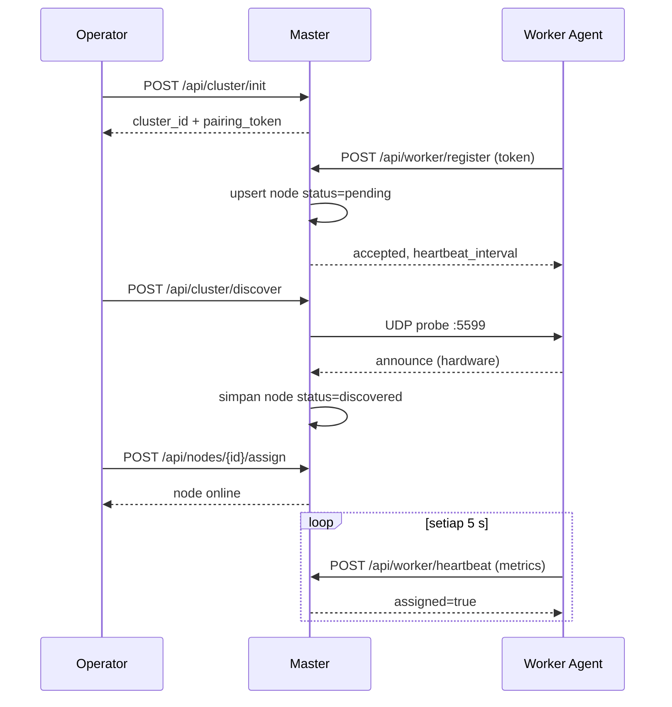

```
Operator → init ──► Master membuat cluster + token
Agent → register ─► Master simpan pending
Operator → scan ──► UDP 5599 → agent membalas → node discovered
Operator → assign ► node online
Agent → heartbeat ► assigned=true → mulai lease
```

### 8.2 Pipeline crawling

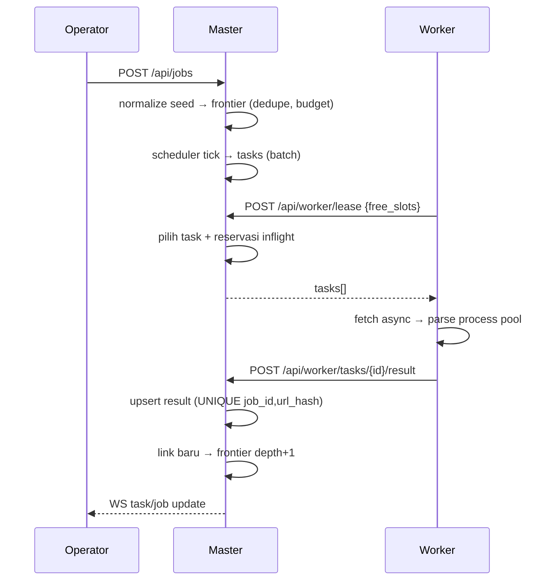

```
POST /jobs ─► frontier(queued) ─► decompose(batch) ─► tasks(queued)
                                                          │
Worker lease ◄─────────────────────────────────────────────┘
   │ fetch+parse
   ▼
POST result ─► results(upsert) + links ─► frontier baru
   │
   └─► finish task → job auto-complete bila kosong
```

### 8.3 Fault tolerance dan requeue

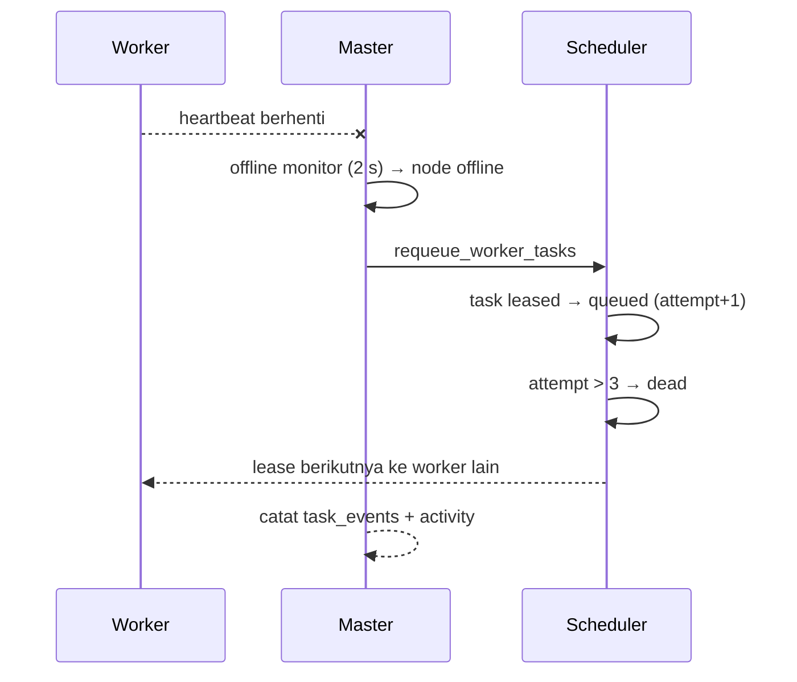

```
heartbeat hilang 15 s
  ├─ node = offline, inflight = 0
  ├─ task leased → queued (attempt + 1)
  ├─ attempt > 3 → dead-letter
  └─ worker lain mengambil task
```

### 8.4 Runner benchmark

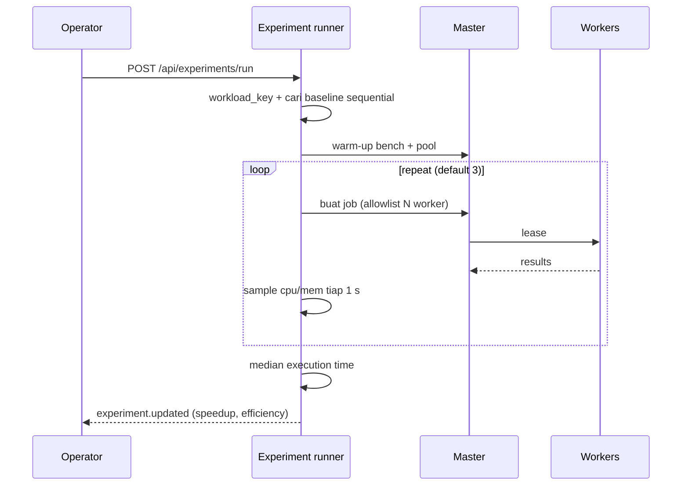

```
run ─► pilih baseline ─► warm-up ─► [job → crawl → result] × repeat
                                        │
                                        └─ median → speedup/efficiency → DB
```

---

## 9. State machine

### 9.1 Job

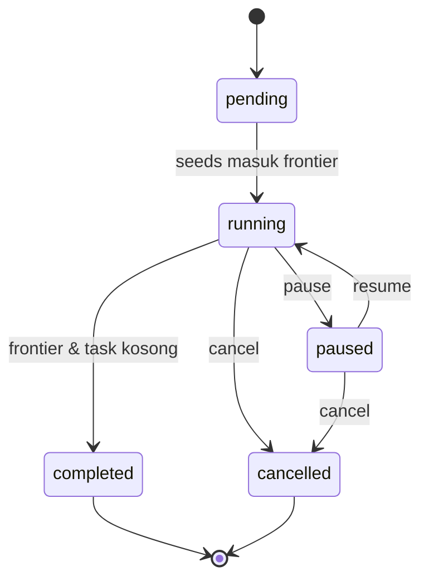

| Status | Arti |
|---|---|
| `pending` | job dibuat, seed belum selesai di-enqueue (transien) |
| `running` | scheduler boleh memberi lease |
| `paused` | leasing dihentikan; task berjalan diselesaikan |
| `completed` | tidak ada frontier aktif dan tidak ada task aktif |
| `cancelled` | operator membatalkan; task/frontier aktif ditandai cancelled |
| `failed` | disediakan untuk kegagalan fatal (belum dipakai runner) |

### 9.2 Task

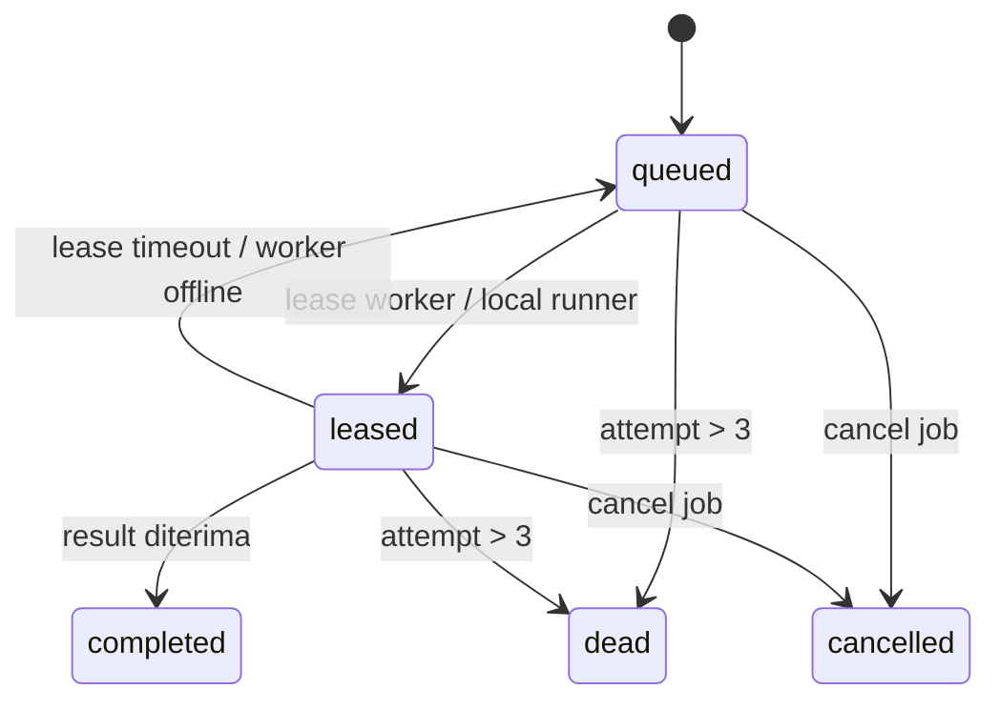

| Status | Arti |
|---|---|
| `queued` | menunggu lease; `assigned_worker` null (dynamic) atau sudah ditentukan (static) |
| `leased` | dipegang satu worker; ada `lease_deadline` |
| `completed` | hasil diterima; frontier URL terkait `finished` |
| `dead` | melewati batas attempt; tidak dijadwalkan lagi |
| `cancelled` | job dibatalkan |

### 9.3 Node

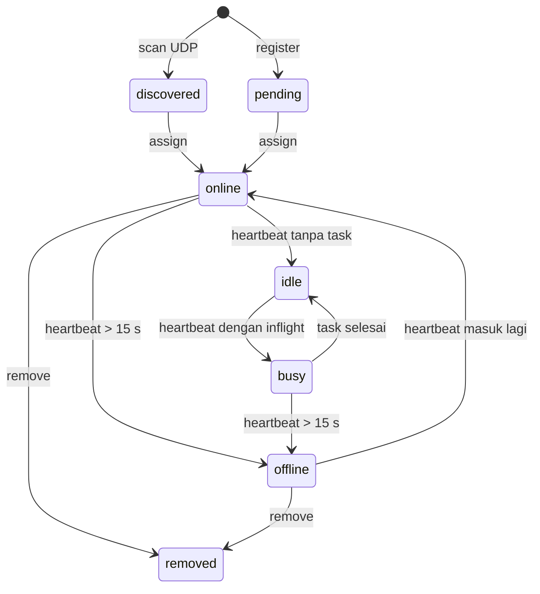

Status `degraded` dan `discovered` tersedia di model; `degraded` belum dipakai scheduler.

---

## 10. Model data

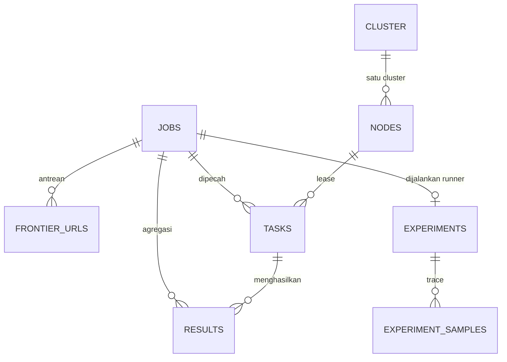

```
CLUSTER(1) ─ nodes
JOBS(1) ──┬─ frontier_urls     UNIQUE(job_id, url_hash)
          ├─ tasks             task_id, urls JSON, attempt
          ├─ results           UNIQUE(job_id, url_hash)
          └─ experiments (opsional, experiment_id)
TASKS(1) ─ results (task_id)
NODES(1) ─ tasks (assigned_worker)
EXPERIMENTS(1) ─ experiment_samples
```

| Tabel | Kunci / indeks | Isi | Dipakai |
|---|---|---|---|
| `cluster` | `id = 1` | cluster_id, token, master_url, discovery_port | ya |
| `nodes` | `worker_id` | identitas, status, hardware, sample resource terakhir | ya |
| `jobs` | `job_id`, status | konfigurasi crawl, mode, allowlist, progres agregat | ya |
| `frontier_urls` | `UNIQUE(job_id,url_hash)`, `(job_id,state)` | antrean URL + depth + state | ya |
| `tasks` | `task_id`, `(job_id,status)` | batch URL, lease, attempt, status | ya |
| `results` | `UNIQUE(job_id,url_hash)` | title, text, hash, status HTTP, worker, waktu | ya |
| `worker_metrics` | `(worker_id, recorded_at)` | time series cpu/mem/throughput | ya |
| `task_events` | `(task_id, created_at)` | audit created/leased/completed/queued | ya |
| `failure_events` | `worker_id`, `detected_at` | rencana laporan recovery | **reserved** |
| `experiments` | `experiment_id`, `group_id` | metrik benchmark + status | ya |
| `experiment_samples` | `(experiment_id, ts_offset_ms)` | trace cpu/mem/pages | ya |
| `events` | `(created_at)` | rencana audit global | **reserved** |

### Invariant

1. Satu cluster per database (`cluster.id = 1`).
2. URL unik per job: `UNIQUE(job_id, url_hash)`.
3. Hasil idempoten: retry tidak menggandakan baris.
4. Budget halaman tidak terlampaui karena `enqueue_urls` memakai lock + hitung sisa.
5. Lease atomik: `asyncio.Lock` + update `inflight` dalam satu alur.
6. `simulated_offline = 1` menahan node tetap offline walau heartbeat masuk.
7. Satu eksperimen aktif; runner lain ditolak `409`.

---

## 11. Kontrak API dan WebSocket

### 11.1 Ringkasan endpoint (34 route `/api`)

| Grup | Endpoint |
|---|---|
| System | `GET /api/health` |
| Cluster | `POST /api/cluster/init`, `GET /api/cluster`, `GET /api/cluster/overview`, `POST /api/cluster/discover` |
| Nodes | `GET /api/nodes`, `GET /api/nodes/{id}`, `POST /api/nodes/{id}/assign|remove|simulate-failure|recover`, `POST /api/nodes/manual` |
| Jobs | `POST /api/jobs`, `GET /api/jobs`, `GET /api/jobs/{id}`, `POST /api/jobs/{id}/pause|resume|cancel`, `GET /api/jobs/{id}/frontier` |
| Tasks | `GET /api/tasks` |
| Results | `GET /api/results`, `GET /api/results/export` |
| Metrics | `GET /api/metrics/timeseries` |
| Experiments | `POST /api/experiments/run`, `GET /api/experiments`, `GET /api/experiments/busy`, `GET /api/experiments/{id}`, `POST /api/experiments/{id}/cancel`, `GET /api/experiments/export` |
| Worker | `POST /api/worker/register|heartbeat|lease`, `POST /api/worker/tasks/{id}/result|fail` |

Bench site: `GET /bench/`, `/bench/{n}.html`, `/bench/robots.txt`, `/bench/_warm`.

Detail payload, contoh request/response, dan kode error ada di [`API.md`](API.md).

### 11.2 Autentikasi

- Endpoint `/api/worker/*` memerlukan header `X-Cluster-Token`.
- Perbandingan memakai `secrets.compare_digest`.
- Token salah → `401`; cluster belum init → `409`.
- Endpoint admin/GUI **belum** memiliki sesi login — gunakan di LAN tepercaya atau tambahkan
  reverse proxy + auth (lihat bagian 18).

### 11.3 Katalog event WebSocket `/ws`

Format: `{ "kind": "...", "ts": "ISO-8601", "payload": {...} }`

| Kind | Payload | Pemantik |
|---|---|---|
| `snapshot` | `Overview` | saat client connect |
| `cluster.initialized` | `ClusterInfo` | init cluster |
| `node.updated` | `NodeOut` | register, heartbeat, assign, recover |
| `node.offline` | `{worker_id, detected_at}` | offline monitor |
| `node.removed` | `{worker_id}` | operator remove |
| `failure.simulated` | `{worker_id}` | tombol simulate failure |
| `task.leased` | `{worker_id, task_ids}` | lease diberikan |
| `task.completed` | `{task_id, job_id, worker_id}` | result diterima |
| `task.requeued` | `{task_id, worker_id, status}` | timeout/offline |
| `task.failed` | `{task_id, worker_id, requeued}` | worker melaporkan gagal |
| `job.updated` | `CrawlJobOut` | create/pause/resume |
| `job.completed` | `CrawlJobOut` | auto-complete |
| `scheduler.tick` | `{tasks_created, job_id}` | dekomposisi task |
| `worker.failed` | `{worker_id, detected_at, affected_tasks}` | offline + requeue |
| `experiment.updated` | experiment row | status/metrik benchmark |
| `pong` | `{clients}` | balasan `ping` |

Frontend `useLiveCluster` memakai snapshot + event ini untuk memperbarui cache TanStack Query tanpa
refresh.

---

## 12. Scheduling dan load balancing

### 12.1 Eligibility

Worker layak diberi lease bila:

```
status ∈ {online, idle, busy}
AND simulated_offline = 0
AND heartbeat < 30 s
AND inflight < capacity
AND cpu_usage ≤ 92%
```

Dynamic mode memakai urutan task global; static mode hanya mengembalikan task yang sudah
di-pre-assign ke worker tersebut.

### 12.2 Skor beban

Formula yang dipakai pada perancangan (Phase 4) dan menjadi dasar pemilihan:

```
load(w) = 0.4·cpu(w) + 0.3·mem(w) + 0.3·(inflight(w) / capacity(w))
```

Pada implementasi lease saat ini, Master tidak menghitung skor untuk setiap kandidat secara
eksplisit; pembatasan dilakukan dengan **capacity reservation** dan **CPU gate**. Worker yang
penuh tidak mendapat lease, sehingga beban mengalir ke worker yang masih punya slot. Mode static
memakai round-robin saat dekomposisi untuk perbandingan eksperimen.

### 12.3 Lease

```
free = capacity − inflight
grant = min(free_slots, free)
task dipilih: status=queued, job running, allowlist cocok
update: status=leased, worker, attempt+1, lease_deadline
node.inflight += grant
```

### 12.4 Metrik performa

```
Speedup    S = T_sequential / T_parallel
Efficiency E = (S / N_worker) × 100%
Throughput   = successful_pages / execution_time
Recovery     = task_finished − failure_detected
```

---

## 13. Konkurensi dan multiprocessing

| Mekanisme | Lokasi | Tujuan |
|---|---|---|
| Satu event loop asyncio | Master | semua koordinasi tanpa thread |
| `_write_lock` | `db/database.py` | serialisasi tulis SQLite |
| `_lease_lock` | `domain/scheduler.py` | cegah dua lease mengambil task sama |
| `_enqueue_lock` | `domain/frontier.py` | jaga budget halaman saat enqueue bersamaan |
| `ProcessPoolExecutor(spawn)` | Worker & local runner | parsing CPU-bound tanpa GIL |
| `asyncio.Semaphore(fetch_concurrency)` | Worker | batasi koneksi keluar |
| `EventHub` drop-on-slow | `domain/hub.py` | GUI lambat tidak memblokir scheduler |

Pembagian beban CPU vs I/O:

```
HTTP fetch  → async (I/O), concurrency 4 (default)
HTML parse  → process pool, pool = min(core−1, config)
```

Jumlah proses pool dan child process dikirim setiap heartbeat, sehingga AC-07 dapat dibuktikan di
GUI.

---

## 14. Fault tolerance

| Parameter | Nilai | Sumber |
|---|---|---|
| Heartbeat interval | 5 s | `AgentConfig.heartbeat_interval` |
| Offline threshold | 15 s | `Settings.offline_threshold` |
| Scanner interval | 2 s | `main._offline_monitor` |
| Lease deadline | `timeout × jumlah_url + 60 s` | `scheduler.lease_tasks` |
| Retry limit | 3 attempt | `tasks.max_attempts` |
| Lease polling | 0.25 s | `AgentConfig.lease_interval` |
| Scheduler tick | 0.5 s | `main._scheduler_loop` |

Jalur pemulihan:

```
node offline
  ├─ requeue_worker_tasks(worker_id)
  │    └─ attempt+1 → queued | attempt>3 → dead
  ├─ frontier state dikembalikan ke queued
  ├─ task_events mencatat alasan
  └─ broadcast worker.failed + task.requeued
```

`failure_events` disiapkan untuk laporan recovery per insiden (detected_at, affected, replacement,
recovered_at) tetapi **belum menulis** — lihat bagian 20.

---

## 15. Subsystem benchmark

| Komponen | Detail |
|---|---|
| Bench site | 300 halaman × ±120 KB, 32 link acak deterministik per halaman, index 40 link |
| Versioning | `BENCH_VERSION = bench-v2` masuk ke `workload_key` |
| Warm-up | `GET /bench/_warm` merender semua halaman + pool dummy parse di luar timer |
| Repeat | default 3 run, diambil median execution time |
| Baseline | eksperimen `sequential` terakhir dengan `workload_key` identik dan `pages_ok > 0` |
| Isolasi | job memakai `worker_allowlist`; hanya N worker terpilih yang boleh lease |
| Sampling | CPU/mem tiap 1 s → `experiment_samples` |
| Guard | run 0 halaman dianggap gagal, tidak menyimpan metrik palsu |
| Tipe aktif | `sequential`, `local_parallel`, `distributed`, `scalability` |
| Tipe manual | `load_balancing`, `fault_tolerance` dijalankan lewat Crawl Jobs + simulasi failure |

Mode `sequential` berjalan di proses Master: concurrency 1, parsing inline (tanpa process pool).
Mode `local_parallel` memakai pool N proses. Mode `distributed` memakai pipeline lease normal.

---

## 16. Konfigurasi

### 16.1 Master — env `CRAWLMESH_*`

| Variabel | Default | Dipakai |
|---|---|---|
| `HOST` | `0.0.0.0` | ya |
| `PORT` | `8000` | ya |
| `DISCOVERY_PORT` | `5599` | ya |
| `DATA_DIR` | `<repo>/data` | ya |
| `HEARTBEAT_INTERVAL` | `5` | ya (dikirim ke agent) |
| `OFFLINE_THRESHOLD` | `15` | ya |
| `DISCOVERY_WINDOW_MS` | `2500` | ya |
| `ALLOW_PRIVATE_TARGETS` | `false` | ya (default SSRF) |
| `DEFAULT_USER_AGENT` | `CrawlMesh/0.1 (+academic-project)` | ya |
| `METRICS_SAMPLE_MS` | `2000` | **reserved** |
| `TASK_RETRY_LIMIT` | `3` | **reserved** (nilai efektif di `tasks.max_attempts`) |
| `LEASE_GRACE_SECONDS` | `60` | **reserved** (nilai efektif inline di scheduler) |
| `SEQUENTIAL_MAX_PAGES` | `50` | **reserved** |

### 16.2 Worker — env `CRAWLMESH_*` / CLI

| Env | CLI | Default | Fungsi |
|---|---|---|---|
| `MASTER_URL` | `--master` | `http://127.0.0.1:8000` | alamat Master |
| `TOKEN` | `--token=` | — | pairing token (wajib) |
| `PORT` | `--port` | `8010` | port agent |
| `WORKER_NAME` | `--name` | hostname | nama tampilan |
| `POOL_SIZE` | `--pool-size` | `core−1` | proses parsing |
| `CAPACITY` | `--capacity` | = pool | slot task paralel |
| `FETCH_CONCURRENCY` | — | `4` | koneksi HTTP paralel |
| `DISCOVERY_PORT` | `--discovery-port` | `5599` | listener UDP |
| `STATE_DIR` | `--state-dir` | `.crawlmesh-agent` | identitas worker stabil |

Gunakan `--token=<TOKEN>` (tanda `=`) bila token diawali karakter `-`.

### 16.3 Port

| Port | Proto | Sisi | Wajib dibuka |
|---|---|---|---|
| 8000 | TCP | Master | ya |
| 8010 | TCP | Worker | ya (onboarding manual) |
| 5599 | UDP | Worker | ya untuk discovery |
| 5173 | TCP | Master (dev) | tidak (hanya Vite dev) |

---

## 17. Deployment

### 17.1 Topologi 10 node

```
                    ┌──────────────┐
                    │   MASTER     │  192.168.x.10:8000
                    │ GUI + API    │  SQLite, bench site
                    └──────┬───────┘
             LAN / switch  │
   ┌───────┬───────┬───────┼───────┬───────┬───────┐
   ▼       ▼       ▼       ▼       ▼       ▼       ▼
  W1      W2      W3      W4      W5      W6    … W9
 :8010   :8010   :8010   :8010   :8010   :8010   :8010
 poll    poll    poll    poll    poll    poll    poll
```

Mermaid:

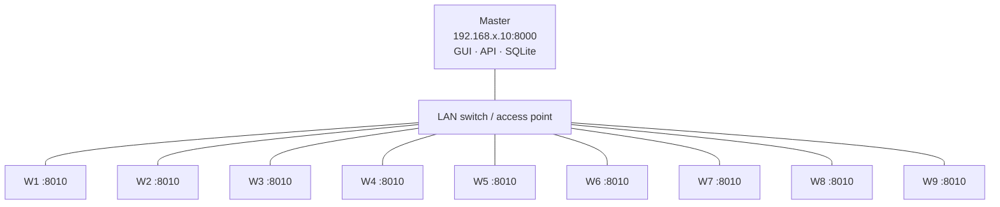

Ketentuan:

- Satu Master, maksimum 9 worker pada target UAS.
- Semua worker berada di LAN yang sama, atau didaftarkan manual per IP.
- AP isolation Wi-Fi harus dimatikan.
- Master tidak perlu membuka koneksi ke worker.

### 17.2 Multi-agent pada satu host

Dipakai untuk demo tanpa 10 mesin. Setiap instance wajib unik:

```
port 8010, discovery 5600, state-dir data/agent-a
port 8011, discovery 5601, state-dir data/agent-b
```

Hanya satu instance dapat memakai discovery default `5599`; instance lain didaftarkan lewat
Add by IP. Catat pada laporan bahwa node bukan mesin fisik terpisah.

### 17.3 Instalasi service

| OS | Script | Mekanisme |
|---|---|---|
| Windows | `scripts/install_agent_windows.ps1` | Task Scheduler, start at boot, restart otomatis |
| Linux | `scripts/install_agent_linux.sh` | systemd unit `crawlmesh-agent.service` |
| Windows dev | `scripts/run_master.ps1`, `run_worker.ps1` | proses foreground |
| Dev GUI | `scripts/dev.ps1` | uvicorn `--reload` + Vite |

---

## 18. Keamanan

| Area | Implementasi | Keterbatasan |
|---|---|---|
| Autentikasi worker | pairing token + `compare_digest` | token dikirim plain HTTP; gunakan LAN tepercaya atau TLS reverse proxy |
| Endpoint admin | tanpa login | jangan ekspos ke internet |
| SSRF | blokir private/loopback/link-local/CGNAT; cek DNS saat fetch | bench site Master diizinkan eksplisit per job |
| Crawl ethics | robots.txt cache, domain delay, User-Agent jelas | bukan pengganti rate limit global |
| Data | SQLite lokal | belum terenkripsi at rest |
| Bypass | tidak ada CAPTCHA/auth bypass | sesuai non-goals |

Rekomendasi produksi: taruh Master di belakang reverse proxy dengan TLS + basic/OIDC auth, dan
batasi port 8000 ke VLAN operator.

---

## 19. Observability dan operasi

| Sinyal | Sumber | Pemakaian |
|---|---|---|
| Health | `GET /api/health` | cek proses + status cluster |
| Overview | `GET /api/cluster/overview` | snapshot dashboard |
| Realtime | WS `/ws` | activity feed, node, job, task, experiment |
| Resource | `worker_metrics` | grafik CPU/mem/throughput |
| Task audit | `task_events` | alasan requeue/dead |
| Benchmark | `experiments` + `experiment_samples` | laporan BAB IV |
| Log | stdout → `data/*.log` saat memakai script | debugging |
| Export | `/api/results/export`, `/api/experiments/export` | lampiran |

Rotasi log belum otomatis. Pada deployment 10 node, arahkan stdout service ke file/journal dan
pantau ukuran `data/crawlmesh.db` (backup dengan menyalin file saat Master berhenti atau memakai
`VACUUM INTO`).

---

## 20. Status implementasi

### 20.1 Matriks acceptance criteria

| AC | Fitur | Status | Bukti / modul |
|---|---|---|---|
| AC-01 | Master initialization | selesai | `cluster.init_cluster`, GUI bootstrap |
| AC-02 | Node discovery | selesai | `discovery.scan_network`, persist `discovered` |
| AC-03 | Role identification | selesai | `nodes.role`, kartu Master/Worker |
| AC-04 | 9 worker terdaftar | selesai (perlu mesin) | assign + heartbeat |
| AC-05 | Heartbeat monitoring | selesai | `cluster.heartbeat`, offline monitor |
| AC-06 | Task decomposition | selesai | `scheduler.decompose_job` |
| AC-07 | Multiprocessing | selesai | pool + `child_processes` metric |
| AC-08 | Distributed processing | selesai | lease + worker |
| AC-09 | Dynamic load balancing | selesai | dynamic vs static, capacity gate |
| AC-10 | Fault detection | selesai | offline threshold 15 s |
| AC-11 | Task recovery | selesai | requeue + attempt + dead-letter |
| AC-12 | Result aggregation | selesai | `aggregator.ingest_results` |
| AC-13 | Performance monitoring | selesai | metrics + chart |
| AC-14 | Benchmarking | selesai | experiment runner |
| AC-15 | Scalability 1/2/4/6/9 | selesai (suite) | `_run_scalability` |
| AC-16 | Export | selesai | results + experiments CSV/JSON |

### 20.2 Gap yang diketahui (jujur)

| Item | Detail | Dampak |
|---|---|---|
| `failure_events` | tabel ada, belum ditulis | laporan recovery per insiden harus dihitung manual |
| `events` | tabel ada, belum dipakai | audit global masih lewat `task_events` + log |
| Failure console | UI belum ada | recovery time belum tampil terstruktur |
| Mode eksperimen `load_balancing` / `fault_tolerance` | ditolak runner | dijalankan manual dari Crawl Jobs + simulasi |
| Admin API auth | belum ada | hanya aman di LAN |
| HA | tidak ada | Master failure menghentikan cluster |
| Topology | grid kartu, bukan graph auto-layout | cukup untuk 10 node |
| Validasi 10 fisik | belum dijalankan | menunggu hari-H |
| Metrik `reserved` di Settings | `metrics_sample_ms`, `task_retry_limit`, `lease_grace_seconds`, `sequential_max_pages` | nilai efektif hardcoded |
| `jobs.pages_crawled/pages_failed` | tidak dipelihara | statistik dihitung saat baca |

### 20.3 Roadmap

- Phase 7: failure console (isi `failure_events`), polish visual, validasi 10 node, rekaman demo.
- Opsional: auth GUI, TLS, retensi data, worker auto-update, PostgreSQL adapter.

---

## 21. Testing dan QA

| Lapis | Alat | Cakupan |
|---|---|---|
| Unit | `pytest` | normalisasi URL, scope, SSRF, lifecycle cluster, dekomposisi/lease/agregasi, budget |
| Integrasi manual | GUI + 2 worker | crawl bench, fault requeue, benchmark suite |
| Dokumen | `tools/guides/capture.py` | screenshot dari state nyata |
| Cetak | `tools/guides/build_html.py` | HTML A4 + TOC + gambar embedded |

Perintah:

```powershell
.\.venv\Scripts\python.exe -m pytest -q
```

Test saat ini: **16 passed**.

Verifikasi dokumen ini tetap akurat:

```powershell
# daftar route aktual
.\.venv\Scripts\python.exe -c "import sys;sys.path.insert(0,'.');from master.app.main import app;print(len([r for r in app.routes if getattr(r,'path','').startswith('/api')]))"

# daftar tabel
.\.venv\Scripts\python.exe -c "import re,pathlib;print(len(re.findall(r'CREATE TABLE',pathlib.Path('master/app/db/schema.sql').read_text())))"
```

---

## 22. Panduan ekstensi

### Menambah endpoint REST

1. Tambah fungsi di `master/app/api/<grup>.py` dengan model Pydantic.
2. Daftarkan router bila baru di `master/app/main.py`.
3. Tambah tipe + method di `web/src/lib/api.ts`.
4. Pakai `useQuery`/`useMutation` di halaman terkait.
5. Tambah test bila logika bisnis baru.

### Menambah tabel atau kolom

1. Edit `master/app/db/schema.sql` (tabel baru) atau tambah di `Database._migrate` (kolom baru).
2. Tambah `expected` mapping pada `_migrate` agar DB lama ikut ter-update.
3. Perbarui repository/queries dan dokumentasi bagian 10.

### Menambah event realtime

1. `await hub.broadcast("nama.event", payload)` di domain.
2. Tambah handler di `web/src/lib/useLiveCluster.ts` + `FEED_KINDS`.
3. Dokumentasikan di bagian 11.3.

### Menambah tipe eksperimen

1. Tambah literal di `api/experiments.py` dan `ExperimentType`.
2. Implementasi cabang di `experiments.py` (`_run_single`/runner baru).
3. Tambah opsi di `web/src/pages/Performance.tsx` + tipe TS.
4. Pastikan `workload_key` tetap sebanding dengan baseline.

### Menambah halaman GUI

1. Buat `web/src/pages/Nama.tsx`.
2. Daftarkan route di `web/src/App.tsx`.
3. Tambah entri navigasi + judul di `Sidebar.tsx`/`AppShell.tsx`.
4. `npm run build` (output langsung ke `master/app/static`).

---

## 23. Referensi

- [`GUIDE.md`](GUIDE.md) — panduan pengguna + deployment 10 node.
- [`API.md`](API.md) — kontrak REST/WS lengkap.
- [`TDD.md`](TDD.md) — desain teknis dan alasan.
- [`BENCHMARK.md`](BENCHMARK.md) — protokol pengukuran BAB IV.
- [`RUNBOOK-10NODES.md`](RUNBOOK-10NODES.md) — checklist operasional.
- [`adr/0001`](adr/0001-sqlite-instead-of-redis-postgres.md) — SQLite vs Redis/PostgreSQL.
- [`adr/0002`](adr/0002-outbound-lease-communication.md) — komunikasi lease outbound-only.
- [`adr/0003`](adr/0003-udp-discovery-and-windows-udp-reset.md) — UDP discovery + reset Windows.
- [`adr/0004`](adr/0004-benchmark-methodology.md) — metodologi benchmark.

### Glosarium

| Istilah | Definisi |
|---|---|
| Frontier | Antrean URL unik yang belum diproses |
| Lease | Hak sementara worker atas satu task |
| Batch | Kumpulan URL dalam satu task |
| Pool | Proses multiprocessing pada worker |
| Capacity | Slot task paralel pada worker |
| Workload key | Hash konfigurasi agar benchmark sebanding |
| Allowlist | Daftar worker yang boleh mengambil task suatu job |
