::: {custom-style="Title"}
LAPORAN PROYEK CRAWLMESH
:::

::: {custom-style="Subtitle"}
Distributed Web Crawler dengan Orkestrasi Master–Worker
:::

::: {custom-style="Body Text"}
**Mata Kuliah:** Komputasi Paralel dan Sistem Terdistribusi

**Tema:** Tema 8 — Distributed Web Crawler

**Disusun oleh:** [PERLU DATA]

**NIM:** [PERLU DATA]

**Program Studi:** [PERLU DATA]

**Institusi:** [PERLU DATA]

**Tahun:** 2026
:::

[[TOC]]

# BAB I PENDAHULUAN

## 1.1 Latar Belakang

Perkembangan web yang sangat cepat membuat kebutuhan pengambilan dan pengolahan informasi dari halaman web semakin besar. Proses web crawling tidak lagi cukup dilakukan terhadap puluhan halaman, tetapi sering dilakukan terhadap ribuan halaman yang tersebar pada banyak domain. Pendekatan sequential dengan satu proses memiliki keterbatasan karena waktu eksekusi tumbuh sebanding dengan jumlah halaman yang diproses.

Komputasi paralel menawarkan cara untuk memecah pekerjaan besar menjadi beberapa pekerjaan kecil yang dapat dieksekusi secara bersamaan. Pada level satu komputer, multiprocessing memungkinkan beberapa proses memanfaatkan beberapa core CPU. Pada level jaringan, sistem terdistribusi memungkinkan pekerjaan yang sama dibagi kepada beberapa komputer yang bekerja sebagai satu kesatuan.

Arsitektur Master–Worker merupakan salah satu pola yang sesuai untuk kebutuhan tersebut. Master berperan sebagai pusat koordinasi, sedangkan Worker berperan sebagai pelaksana pekerjaan. Pola ini memungkinkan distribusi task, pemantauan kondisi Worker, pengumpulan hasil, serta pemulihan task ketika terjadi kegagalan.

CrawlMesh dikembangkan sebagai implementasi Distributed Web Crawler berbasis Master–Worker. Sistem menyediakan GUI untuk mengelola cluster, mendistribusikan pekerjaan crawling, memantau kondisi node, menguji fault tolerance, dan mengukur performa sistem. Fokus utama proyek bukan sekadar mengambil konten halaman web, tetapi membuktikan bahwa satu pekerjaan crawling dapat dipecah, didistribusikan, dieksekusi secara paralel, dan dipulihkan ketika salah satu Worker mengalami kegagalan.

## 1.2 Tujuan

Tujuan proyek CrawlMesh adalah:

1. Mengembangkan aplikasi Distributed Web Crawler berbasis arsitektur Master–Worker.
2. Menerapkan task decomposition pada proses crawling.
3. Menerapkan parallel processing menggunakan multiprocessing pada setiap Worker.
4. Menerapkan distributed processing melalui komunikasi jaringan antara Master dan Worker.
5. Mengimplementasikan dynamic load balancing berbasis kondisi resource Worker.
6. Mengimplementasikan fault tolerance melalui heartbeat, retry, dan requeue.
7. Mengevaluasi performa melalui pengujian sequential, local parallel, dan distributed processing.
8. Menganalisis scalability berdasarkan variasi jumlah Worker 1, 2, 4, 6, dan 9.
9. Menyediakan antarmuka GUI untuk pengelolaan cluster dan pemantauan proses crawling.
10. Menyediakan data pengukuran yang dapat direproduksi untuk keperluan evaluasi akademik.

# BAB II STUDI PUSTAKA

*Outline awal — dikembangkan pada tahap berikutnya.*

## 2.1 Landasan Teori

### 2.1.1 Web Crawling

Web crawler adalah program yang menjelajahi halaman web secara sistematis untuk menemukan, mengambil, dan mengekstrak informasi. Proses utama meliputi penentuan URL awal (seed), pengambilan halaman melalui HTTP, parsing HTML, ekstraksi tautan, serta penambahan tautan baru ke antrean.

Konsep penting pada web crawling adalah URL frontier, yaitu antrean URL yang akan diproses. Frontier perlu dilengkapi dengan normalisasi URL, deduplication, pembatasan domain, pembatasan kedalaman, dan pembatasan jumlah halaman agar crawling tetap terkendali. Aspek etika dan kepatuhan juga penting, terutama robots.txt, user agent, dan jeda permintaan per domain.

### 2.1.2 Komputasi Paralel

Komputasi paralel adalah eksekusi beberapa instruksi atau pekerjaan secara bersamaan untuk mempercepat penyelesaian tugas. Pada satu komputer, paralelisme dapat dilakukan melalui thread atau proses. Untuk pekerjaan yang didominasi CPU, multiprocessing lebih sesuai karena setiap proses memiliki interpreter dan ruang memori sendiri sehingga tidak terikat oleh Global Interpreter Lock pada Python.

Task decomposition adalah proses memecah pekerjaan besar menjadi task independen yang dapat dieksekusi secara paralel. Pada CrawlMesh, satu crawl job dipecah menjadi beberapa task yang masing-masing berisi sejumlah URL. Ukuran batch, kedalaman, dan prioritas task menjadi parameter penting dalam dekomposisi.

### 2.1.3 Sistem Terdistribusi

Sistem terdistribusi adalah kumpulan komputer yang bekerja sebagai satu sistem dan berkomunikasi melalui jaringan. Karakteristik utamanya meliputi concurrency, tidak adanya global clock, kemungkinan kegagalan partial, dan kebutuhan koordinasi antar-node.

Arsitektur Master–Worker membagi peran secara jelas. Master mengelola cluster, menyimpan state, dan mendistribusikan pekerjaan. Worker menerima pekerjaan, mengeksekusinya, dan mengirimkan hasil. Pada CrawlMesh, komunikasi Worker ke Master menggunakan HTTP, sedangkan GUI menerima pembaruan melalui WebSocket.

### 2.1.4 Dynamic Load Balancing

Load balancing adalah proses mendistribusikan pekerjaan agar beban antar-Worker relatif seimbang. Static load balancing membagi pekerjaan berdasarkan aturan tetap, misalnya round-robin. Dynamic load balancing mempertimbangkan kondisi aktual Worker, seperti CPU, memory, jumlah task aktif, dan kapasitas proses.

Resource-aware scheduling memungkinkan Master mengurangi alokasi task kepada Worker yang sudah sibuk dan mengalihkan task kepada Worker yang masih memiliki kapasitas. Pada implementasi CrawlMesh, mekanisme ini dilakukan melalui lease pull, capacity reservation, dan CPU gate.

### 2.1.5 Fault Tolerance

Fault tolerance adalah kemampuan sistem untuk tetap menyelesaikan pekerjaan ketika terjadi kegagalan pada sebagian komponen. Pada sistem Master–Worker, kegagalan Worker dapat dideteksi melalui heartbeat. Jika heartbeat tidak diterima dalam batas waktu tertentu, Worker ditandai offline dan task yang belum selesai dikembalikan ke antrean.

Mekanisme retry dan requeue memungkinkan task diproses ulang oleh Worker lain. Attempt count membatasi jumlah percobaan agar task yang terus gagal tidak diproses tanpa batas. Recovery time digunakan untuk mengukur berapa lama sistem memulihkan pekerjaan setelah kegagalan terdeteksi.

### 2.1.6 Evaluasi Performa

Evaluasi performa komputasi paralel dan terdistribusi menggunakan beberapa metrik utama: execution time, speedup, efficiency, throughput, CPU utilization, memory utilization, recovery time, dan scalability. Metrik tersebut dijelaskan lebih lanjut pada BAB III.

Pengukuran harus menggunakan workload yang sama, baseline yang sama, dan kondisi pengujian yang dicatat. Tanpa kontrol tersebut, perbandingan performa dapat menyesatkan. CrawlMesh menggunakan workload key, warm-up, dan median dari beberapa pengulangan untuk mengurangi variasi pengukuran.

## 2.2 Konsep dan Teknologi Pendukung

Teknologi yang digunakan dalam implementasi CrawlMesh meliputi:

- Python sebagai bahasa implementasi Master dan Worker.
- FastAPI sebagai framework API Master dan penyedia GUI.
- SQLite dengan mode WAL sebagai penyimpanan state, frontier, task, dan hasil.
- React, TypeScript, dan Tailwind CSS sebagai antarmuka GUI.
- HTTP dan WebSocket sebagai media komunikasi.
- UDP broadcast sebagai mekanisme discovery Worker pada LAN.
- `ProcessPoolExecutor` dan modul `multiprocessing` untuk parallel processing.
- `httpx` untuk HTTP client asinkron.
- `psutil` untuk monitoring CPU, memory, dan proses.
- Recharts untuk visualisasi monitoring dan benchmark.

Referensi teknis untuk teknologi tersebut dicantumkan pada Daftar Referensi. Pemilihan teknologi mengikuti kondisi laboratorium dan kebutuhan demonstrasi, bukan ketentuan wajib dari dokumen UAS.

# BAB III METODOLOGI

## 3.1 Rancangan Percobaan

### 3.1.1 Tujuan Percobaan

Percobaan dirancang untuk mengetahui:

1. Efektivitas pemrosesan paralel dibandingkan sequential.
2. Efektivitas pemrosesan terdistribusi dibandingkan pemrosesan pada satu komputer.
3. Pengaruh jumlah Worker terhadap execution time, speedup, dan efficiency.
4. Efektivitas dynamic load balancing dibandingkan static scheduling.
5. Kemampuan sistem memulihkan task ketika Worker mengalami kegagalan.

### 3.1.2 Variabel Percobaan

| Jenis variabel | Variabel | Keterangan |
|---|---|---|
| Bebas | Mode pemrosesan | Sequential, local parallel, distributed |
| Bebas | Jumlah Worker | 1, 2, 4, 6, dan 9 Worker |
| Bebas | Strategi scheduling | Static dan dynamic |
| Terikat | Execution time | Waktu penyelesaian job |
| Terikat | Speedup | Perbandingan terhadap baseline sequential |
| Terikat | Efficiency | Efektivitas penggunaan unit pemrosesan |
| Terikat | Throughput | Halaman berhasil per satuan waktu |
| Terikat | CPU utilization | Rata-rata penggunaan CPU |
| Terikat | Memory utilization | Rata-rata penggunaan RAM |
| Terikat | Recovery time | Waktu pemulihan setelah kegagalan |
| Kontrol | Workload | Seed, batas halaman, kedalaman, batch, timeout |
| Kontrol | Lingkungan | Hardware node, jaringan, dan kondisi cluster |

: Tabel 3.1 — Variabel percobaan

### 3.1.3 Skenario Eksperimen

| ID | Skenario | Konfigurasi | Metrik utama |
|---|---|---|---|
| EXP-01 | Sequential processing | 1 proses pada satu komputer | Execution time, throughput, CPU, memory |
| EXP-02 | Local parallel processing | Beberapa proses pada satu komputer | Execution time, speedup, efficiency, CPU, memory |
| EXP-03 | Distributed processing | 1 Master dan beberapa Worker | Execution time, speedup, throughput, distribusi task |
| EXP-04 | Dynamic load balancing | Static vs dynamic pada workload sama | Distribusi task, execution time, resource |
| EXP-05 | Fault tolerance | Worker dihentikan saat job berjalan | Detection time, requeue, recovery time |
| EXP-06 | Scalability | 1, 2, 4, 6, dan 9 Worker | Speedup dan efficiency |

: Tabel 3.2 — Skenario eksperimen

Setiap skenario menggunakan workload yang sama agar hasil dapat dibandingkan. Pada EXP-01 dan EXP-02, seluruh proses dijalankan pada satu komputer. Pada EXP-03 dan EXP-06, task didistribusikan melalui jaringan ke Worker yang terdaftar. Pada EXP-04, konfigurasi static dan dynamic dijalankan pada jumlah Worker yang sama. Pada EXP-05, kegagalan disimulasikan melalui GUI atau dengan menghentikan agent.

### 3.1.4 Rumus Metrik

Execution time dihitung dari selisih waktu selesai dan waktu mulai:

$$
T = t_{\text{finish}} - t_{\text{start}}
\qquad (3.1)
$$

Speedup membandingkan waktu sequential dengan waktu paralel:

$$
S = \frac{T_{\text{seq}}}{T_{\text{par}}}
\qquad (3.2)
$$

Efficiency mengukur efektivitas penggunaan sejumlah unit pemrosesan:

$$
E = \frac{S}{P} \times 100\%
\qquad (3.3)
$$

dengan $P$ adalah jumlah process atau Worker sesuai konteks eksperimen.

Throughput mengukur jumlah halaman berhasil per satuan waktu:

$$
X = \frac{N_{\text{success}}}{T}
\qquad (3.4)
$$

CPU utilization dihitung sebagai rata-rata sampel selama eksperimen:

$$
\bar{U}_{\text{CPU}} = \frac{1}{K}\sum_{k=1}^{K} U_{\text{CPU},k}
\qquad (3.5)
$$

Memory utilization dihitung dari perbandingan RAM terpakai terhadap RAM total:

$$
U_{\text{mem}} = \frac{M_{\text{used}}}{M_{\text{total}}} \times 100\%
\qquad (3.6)
$$

Recovery time dihitung dari waktu kegagalan terdeteksi sampai task berhasil dipulihkan:

$$
T_{\text{rec}} = t_{\text{recovered}} - t_{\text{detected}}
\qquad (3.7)
$$

Pada implementasi lease, jumlah task yang diberikan kepada Worker dibatasi oleh kapasitas dan jumlah task yang sedang berjalan:

$$
g(w) = \min\left(f_{\text{slot}}, C_w - I_w\right)
\qquad (3.8)
$$

dengan $f_{\text{slot}}$ adalah slot yang diminta Worker, $C_w$ adalah capacity Worker, dan $I_w$ adalah jumlah task inflight.

Formula beban berikut digunakan sebagai dasar perancangan, tetapi bukan formula yang dihitung secara eksplisit pada implementasi lease saat ini:

$$
L(w) = 0.4U_{\text{CPU}}(w) + 0.3U_{\text{mem}}(w) + 0.3\frac{I_w}{C_w}
\qquad (3.9)
$$

| Simbol | Arti | Satuan |
|---|---|---|
| $T$ | Execution time | detik |
| $T_{\text{seq}}$ | Waktu baseline sequential | detik |
| $T_{\text{par}}$ | Waktu eksekusi paralel | detik |
| $S$ | Speedup | kali |
| $E$ | Efficiency | persen |
| $P$ | Jumlah process atau Worker | unit |
| $N_{\text{success}}$ | Jumlah halaman berhasil | halaman |
| $X$ | Throughput | halaman/detik |
| $U_{\text{CPU}}$ | CPU utilization | persen |
| $U_{\text{mem}}$ | Memory utilization | persen |
| $T_{\text{rec}}$ | Recovery time | detik |
| $C_w$ | Capacity Worker | task |
| $I_w$ | Inflight Worker | task |

: Tabel 3.3 — Simbol dan satuan metrik

### 3.1.5 Kontrol Eksperimen

Agar hasil pengukuran dapat dipertanggungjawabkan, eksperimen dikendalikan melalui ketentuan berikut:

- Workload key dihitung dari seed, maximum pages, maximum depth, batch size, request timeout, dan versi bench site. Speedup hanya dibandingkan dengan baseline yang memiliki workload key sama.
- Bench site statis deterministik digunakan sebagai target utama. Bench site menyediakan 300 halaman, sekitar 120 KB per halaman, dan tautan yang deterministik.
- Warm-up dilakukan sebelum timer berjalan. Tujuannya menghindari biaya pembentukan process pool dan cache awal.
- Setiap eksperimen diulang tiga kali, lalu diambil median execution time.
- Hanya satu eksperimen yang boleh berjalan pada satu waktu.
- Setiap eksperimen distributed mencantumkan allowlist Worker agar jumlah Worker yang diuji tidak terpengaruh Worker lain.
- CPU dan memory disampel setiap satu detik selama eksperimen.
- Spesifikasi hardware setiap node dan kondisi jaringan dicatat sebelum pengukuran.
- Hasil pengukuran harus disimpan dalam Experiment History dan diekspor ke CSV.

## 3.2 Arsitektur Sistem dan Topologi

### 3.2.1 Gambaran Arsitektur Master–Worker

CrawlMesh menggunakan satu Master sebagai pusat koordinasi dan sejumlah Worker sebagai pelaksana crawling. Master menyediakan GUI, API, scheduler, frontier, load balancer, fault tolerance, result aggregator, metrics collector, dan penyimpanan SQLite. Worker menjalankan agent, melakukan HTTP fetch, memproses HTML melalui process pool, dan mengirimkan hasil kepada Master.

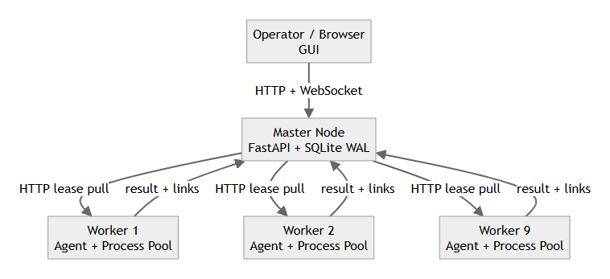{width=13.5cm}

Interaksi utama berlangsung melalui HTTP. Worker tidak membuka port inbound untuk menerima task. Sebaliknya, Worker melakukan lease pull kepada Master secara periodik. Pola ini dipilih agar Worker tetap dapat berjalan di balik firewall atau NAT tanpa konfigurasi port forwarding.

### 3.2.2 Peran Master dan Worker

| Komponen | Tanggung jawab |
|---|---|
| Master | Inisialisasi cluster, registrasi node, discovery, heartbeat, frontier, task decomposition, scheduling, load balancing, fault tolerance, agregasi hasil, metrik, dan GUI |
| Worker | Registrasi, heartbeat, lease task, HTTP fetch, parsing HTML, multiprocessing, ekstraksi link, pengiriman hasil, dan resource monitoring |
| GUI | Menampilkan dashboard, discovery, topologi, job, task, hasil, benchmark, dan pengaturan |
| SQLite | Menyimpan cluster, node, job, frontier, task, result, metrik, dan experiment |
| Bench site | Menyediakan halaman statis deterministik untuk pengujian |

: Tabel 3.4 — Peran komponen sistem

### 3.2.3 Mekanisme Komunikasi

| Komunikasi | Arah | Media | Fungsi |
|---|---|---|---|
| Registration | Worker ke Master | HTTP POST | Mendaftarkan Worker dan identitas node |
| Heartbeat | Worker ke Master | HTTP POST | Melaporkan status dan resource |
| Discovery | Master ke Worker | UDP broadcast | Mencari agent pada LAN |
| Task lease | Worker ke Master | HTTP POST | Meminta task sesuai kapasitas |
| Task result | Worker ke Master | HTTP POST | Mengirim hasil crawling dan link baru |
| Task failure | Worker ke Master | HTTP POST | Melaporkan kegagalan task |
| GUI update | Master ke Browser | WebSocket | Mengirim snapshot dan event |
| Benchmark | GUI ke Master | HTTP POST | Menjalankan eksperimen |

: Tabel 3.5 — Mekanisme komunikasi

Setiap request Worker ke endpoint `/api/worker/*` menyertakan header `X-Cluster-Token`. Token dihasilkan saat inisialisasi cluster dan ditampilkan pada halaman Settings. Dengan demikian, Worker yang tidak memiliki token tidak dapat mendaftar atau mengambil task.

### 3.2.4 Distribusi Task dan Agregasi Hasil

Master menyimpan URL pada tabel `frontier_urls` dengan kombinasi unik `(job_id, url_hash)`. URL yang lolos normalisasi, scope domain, batas kedalaman, dan batas halaman akan masuk ke frontier. Scheduler memecah URL menjadi task berukuran batch dan menempatkannya pada antrean task.

Worker meminta task melalui lease. Master memilih task yang sesuai, menandainya leased, menaikkan attempt count, dan menetapkan lease deadline. Setelah Worker selesai, hasil dikirim ke Master. Master menyimpan hasil dengan deduplication berdasarkan `(job_id, url_hash)`, menambahkan link baru ke frontier, lalu menandai task selesai.

### 3.2.5 Penyimpanan dan Monitoring

CrawlMesh menggunakan SQLite dengan mode Write-Ahead Logging. SQLite dipilih karena tidak memerlukan layanan terpisah dan cukup untuk skala demonstrasi laboratorium. Penulisan diserialisasi melalui lock pada lapisan database untuk menghindari konflik antar-request.

Monitoring dilakukan melalui heartbeat dan tabel `worker_metrics`. Setiap heartbeat mencatat CPU, memory, jumlah proses anak, jumlah task aktif, inflight, capacity, dan throughput. GUI menerima event melalui WebSocket dan memperbarui tampilan tanpa refresh manual.

### 3.2.6 Topologi 10 Node

Target UAS adalah 1 Master dan 9 Worker pada 10 komputer fisik. Topologi logis ditunjukkan pada Gambar 3.2. Setiap Worker terhubung ke Master melalui LAN dan tidak memerlukan koneksi inbound dari Master.

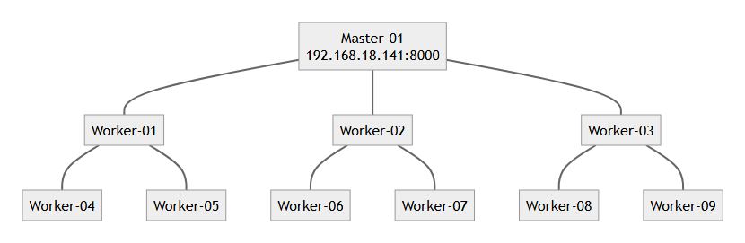{width=12.5cm}

Pada kondisi repository saat ini, data konfigurasi yang tersedia hanya untuk Master. Spesifikasi Worker 1 sampai 9 belum tersedia dan ditandai `[PERLU DATA]` pada Tabel 3.6. Dengan demikian, klaim bahwa 10 node fisik telah diverifikasi tidak boleh dibuat sampai data aktual tersedia.

## 3.3 Mekanisme Kerja

### 3.3.1 Inisialisasi Master

Master diinisialisasi melalui `POST /api/cluster/init`. Proses ini membuat cluster ID, pairing token, dan record node Master. Cluster ID menggunakan format `CM-` diikuti enam karakter heksadesimal. Pairing token dibuat menggunakan `secrets.token_urlsafe(24)`.

Setelah inisialisasi, Master menyediakan endpoint API, WebSocket, dan GUI. Master juga menjalankan dua loop latar belakang: offline monitor setiap dua detik dan scheduler tick setiap 0,5 detik.

### 3.3.2 Discovery dan Registrasi Worker

Discovery dilakukan dengan mengirim probe UDP ke alamat broadcast `255.255.255.255` dan loopback pada port 5599. Agent yang mendengarkan port tersebut membalas dengan informasi hardware. Master menunggu selama 2,5 detik dan mengumpulkan balasan.

Hasil discovery ditampilkan pada halaman Node Discovery. Node yang ditemukan disimpan dengan status `discovered`. Operator kemudian menekan Assign as Worker untuk mengubah status menjadi `online`. Worker yang sudah memiliki token dapat melakukan registrasi langsung melalui `POST /api/worker/register`.

Fallback discovery disediakan melalui Add Worker by IP Address. Master melakukan probe ke `/agent/info` pada alamat dan port yang dimasukkan. Dengan cara ini, Worker pada subnet berbeda tetap dapat didaftarkan.

### 3.3.3 Heartbeat dan Monitoring Node

Worker mengirim heartbeat setiap lima detik. Payload heartbeat berisi CPU usage, memory usage, jumlah proses, jumlah task aktif, inflight, capacity, throughput, dan rata-rata waktu pemrosesan. Master menyimpan nilai terbaru pada tabel `nodes` dan menambahkan sampel ke tabel `worker_metrics`.

Status Worker berubah menjadi `idle` jika tidak ada task, `busy` jika ada task, dan `offline` jika heartbeat melewati ambang 15 detik. Status `offline` juga dapat dihasilkan dari simulasi kegagalan melalui GUI.

### 3.3.4 Pembuatan Job dan URL Frontier

Job dibuat melalui `POST /api/jobs` atau halaman Crawl Jobs. Master memvalidasi seed URL, melakukan normalisasi, menentukan allowed domains, dan memeriksa apakah target merupakan jaringan privat. Target privat diblokir secara default untuk mengurangi risiko SSRF. Pengecualian diberikan untuk bench site lokal yang dikelola Master.

Seed URL dimasukkan ke frontier dengan state `queued`. Setiap URL baru dinormalisasi, dicek terhadap domain yang diizinkan, dicek terhadap batas kedalaman, dan dicek terhadap batas jumlah halaman. Kombinasi `(job_id, url_hash)` mencegah duplikasi.

### 3.3.5 Task Decomposition

Scheduler mengambil URL berstatus queued sesuai urutan prioritas dan waktu masuk. Sejumlah URL dikelompokkan menjadi satu task sesuai batch size. Setiap task memiliki task ID, job ID, daftar URL, kedalaman, prioritas, assigned Worker, attempt count, dan status.

Pada mode static, task langsung diberikan kepada Worker secara round-robin saat dekomposisi. Pada mode dynamic, task dibiarkan tanpa assigned Worker dan dipilih melalui lease. Jumlah task queued dibatasi sekitar dua kali total capacity Worker agar antrean tidak tumbuh tanpa kendali.

### 3.3.6 Scheduling dan Load Balancing

Worker meminta task melalui `POST /api/worker/lease` dengan menyertakan `free_slots`. Master memeriksa status Worker, heartbeat, capacity, inflight, dan CPU usage. Jika Worker aktif dan masih memiliki ruang, Master menghitung grant:

$$
g(w) = \min\left(f_{\text{slot}}, C_w - I_w\right)
\qquad (3.8)
$$

Task yang dipilih adalah task queued pada job running yang sesuai dengan allowlist. Master menandai task leased, menaikkan attempt count, menetapkan lease deadline, dan menambah inflight Worker.

Pada implementasi saat ini, dynamic load balancing dilakukan melalui capacity reservation dan CPU gate. Worker yang penuh tidak mendapat lease, sehingga beban mengalir ke Worker yang masih memiliki slot. Worker dengan CPU usage di atas 92 persen juga tidak diberi lease baru.

Formula weighted least loaded pada Persamaan (3.9) merupakan rancangan yang menjadi dasar pemilihan, tetapi belum dihitung secara eksplisit untuk setiap kandidat pada implementasi lease. Laporan ini membedakan keduanya agar tidak terjadi klaim yang berlebihan.

### 3.3.7 Eksekusi Crawling dan Multiprocessing

Worker menerima batch URL, melakukan HTTP fetch secara asinkron, dan mengirim konten HTML ke process pool. Process pool menggunakan `ProcessPoolExecutor` dengan context `spawn`. Setiap proses melakukan parsing HTML, ekstraksi title, ekstraksi teks, ekstraksi link, normalisasi URL, dan content hashing.

Jumlah proses pool secara default adalah jumlah core CPU dikurangi satu, dengan nilai minimum satu. Jumlah process dan child process dilaporkan melalui heartbeat sehingga penggunaan multiprocessing dapat dibuktikan pada GUI.

HTTP fetch dibatasi oleh `fetch_concurrency` dan semaphore. robots.txt dihormati jika diaktifkan, dengan cache per origin selama satu jam. Domain delay diterapkan per host untuk mengurangi tekanan terhadap server target.

### 3.3.8 Fault Tolerance

Master menjalankan offline monitor setiap dua detik. Jika heartbeat terakhir lebih lama dari 15 detik, Worker ditandai offline. Task yang masih berstatus leased atau running milik Worker tersebut dikembalikan ke antrean.

Setiap task memiliki attempt count dan maksimum tiga percobaan. Jika attempt count belum mencapai batas, task dikembalikan ke state queued dan dapat diambil Worker lain. Jika batas terlampaui, task dipindahkan ke status dead dan dicatat sebagai kegagalan.

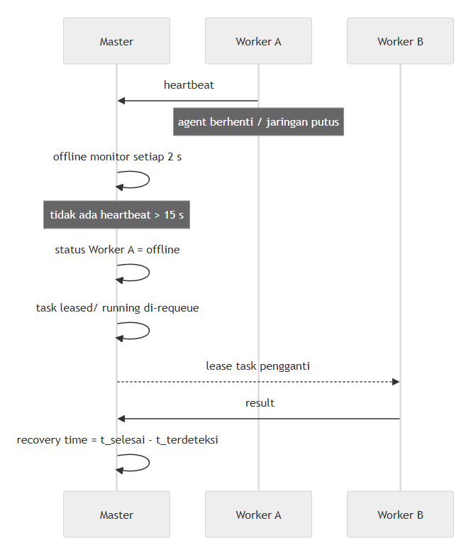{width=11.5cm}

Recovery time dihitung dari waktu kegagalan terdeteksi sampai task berhasil diselesaikan kembali. Pada implementasi saat ini, tabel `failure_events` tersedia tetapi belum diisi secara otomatis. Karena itu, recovery time per insiden harus dihitung dari log atau `task_events` dan tidak boleh diklaim sebagai metrik terstruktur sampai instrumentasi dilengkapi.

### 3.3.9 Agregasi Hasil dan Deduplication

Hasil crawling disimpan pada tabel `results` dengan kunci unik `(job_id, url_hash)`. Jika Worker mengirim hasil yang sama akibat retry, insert kedua diabaikan. Master mencatat jumlah accepted, duplicates, dan failed.

Link yang ditemukan Worker ditambahkan ke frontier dengan kedalaman berikutnya. Link tersebut harus lolos normalisasi, scope domain, batas kedalaman, dan batas halaman. Job dinyatakan selesai jika tidak ada lagi frontier queued atau scheduled dan tidak ada task queued, leased, atau running.

## 3.4 Konfigurasi Node dan Jaringan

### 3.4.1 Konfigurasi Node

| Node | Role | Hostname | IP | OS | CPU | RAM |
|---|---|---|---|---|---|---|
| Master-01 | Master | FCM-LOQ | 192.168.18.141 | Windows 11 | 16 core | 21.144.231.936 byte |
| Worker-01 | Worker | [PERLU DATA] | [PERLU DATA] | [PERLU DATA] | [PERLU DATA] | [PERLU DATA] |
| Worker-02 | Worker | [PERLU DATA] | [PERLU DATA] | [PERLU DATA] | [PERLU DATA] | [PERLU DATA] |
| Worker-03 | Worker | [PERLU DATA] | [PERLU DATA] | [PERLU DATA] | [PERLU DATA] | [PERLU DATA] |
| Worker-04 | Worker | [PERLU DATA] | [PERLU DATA] | [PERLU DATA] | [PERLU DATA] | [PERLU DATA] |
| Worker-05 | Worker | [PERLU DATA] | [PERLU DATA] | [PERLU DATA] | [PERLU DATA] | [PERLU DATA] |
| Worker-06 | Worker | [PERLU DATA] | [PERLU DATA] | [PERLU DATA] | [PERLU DATA] | [PERLU DATA] |
| Worker-07 | Worker | [PERLU DATA] | [PERLU DATA] | [PERLU DATA] | [PERLU DATA] | [PERLU DATA] |
| Worker-08 | Worker | [PERLU DATA] | [PERLU DATA] | [PERLU DATA] | [PERLU DATA] | [PERLU DATA] |
| Worker-09 | Worker | [PERLU DATA] | [PERLU DATA] | [PERLU DATA] | [PERLU DATA] | [PERLU DATA] |

: Tabel 3.6 — Konfigurasi node

Data Master diambil dari record cluster pada database. Spesifikasi Worker belum tersedia pada repository dan harus diisi dari inventaris laboratorium sebelum laporan final.

### 3.4.2 Konfigurasi Jaringan

| Parameter | Konfigurasi |
|---|---|
| Media jaringan | [PERLU DATA] |
| Subnet | [PERLU DATA] |
| Gateway | [PERLU DATA] |
| IP Master | 192.168.18.141 |
| IP Worker | [PERLU DATA] |
| Protokol komunikasi | HTTP, WebSocket, UDP |
| Port Master | 8000/TCP |
| Port agent | 8010/TCP |
| Port discovery | 5599/UDP |
| Firewall | [PERLU DATA] |
| DNS/Hostname | [PERLU DATA] |

: Tabel 3.7 — Konfigurasi jaringan

### 3.4.3 Konfigurasi Runtime

| Komponen | Konfigurasi aktual |
|---|---|
| Bahasa | Python 3.13.14 |
| Master framework | FastAPI 0.121.1, Uvicorn 0.38.0 |
| Database | SQLite dengan WAL melalui aiosqlite 0.21.0 |
| HTTP client | httpx 0.28.1 |
| Monitoring | psutil 7.1.3 |
| Validasi model | Pydantic 2.12.4 |
| WebSocket | websockets 15.0.1 |
| GUI | React 18.3.1, TypeScript 5.7.2, Vite 6.0.5, Tailwind CSS 4.0 |
| Grafik | Recharts 2.15.0 |
| Worker multiprocessing | ProcessPoolExecutor dengan context spawn |
| Pool size default | Maksimum 1, atau jumlah core CPU dikurangi 1 |
| Fetch concurrency default | 4 |
| Batas ukuran respons | 3.000.000 byte |
| Cache robots.txt | 1 jam per origin |

: Tabel 3.8 — Konfigurasi runtime

Perintah menjalankan Master dan Worker:

```powershell
.\scripts\run_master.ps1
.\scripts\run_worker.ps1 -Master http://192.168.18.141:8000 `
    -Token '<PAIRING_TOKEN>' -PoolSize 4
```

Environment variable utama:

- `CRAWLMESH_MASTER_URL` — alamat Master yang dihubungi Worker.
- `CRAWLMESH_TOKEN` — pairing token cluster.
- `CRAWLMESH_PORT` — port Master atau agent.
- `CRAWLMESH_POOL_SIZE` — jumlah proses parser pada Worker.
- `CRAWLMESH_DISCOVERY_PORT` — port UDP discovery.

### 3.4.4 Parameter Operasional

| Parameter | Nilai | Sumber |
|---|---|---|
| Heartbeat interval | 5 detik | `AgentConfig.heartbeat_interval` |
| Offline threshold | 15 detik | `Settings.offline_threshold` |
| Offline monitor interval | 2 detik | `main._offline_monitor` |
| Scheduler tick | 0,5 detik | `main._scheduler_loop` |
| Lease polling | 0,25 detik | `AgentConfig.lease_interval` |
| Lease deadline | timeout × jumlah URL + 60 detik | `scheduler.lease_tasks` |
| Retry limit | 3 attempt | `tasks.max_attempts` |
| CPU gate | 92 persen | `scheduler.lease_tasks` |
| Discovery window | 2,5 detik | `Settings.discovery_window_ms` |
| Bench page count | 300 halaman | `api/bench.py` |
| Bench page size | sekitar 120 KB | `api/bench.py` |

: Tabel 3.9 — Parameter operasional

# BAB IV HASIL DAN PEMBAHASAN

## 4.1 Implementasi

Bagian ini menjelaskan hasil pengembangan sistem berdasarkan implementasi yang tersedia pada repository. Pembahasan dibatasi pada fitur yang dapat diverifikasi melalui source code, konfigurasi, screenshot, atau log.

### 4.1.1 Implementasi Master

Master diimplementasikan sebagai aplikasi FastAPI yang dijalankan oleh Uvicorn pada port 8000. Aplikasi memiliki lifespan handler yang membuka database, membuat EventHub, dan menjalankan offline monitor serta scheduler tick.

Modul utama Master meliputi:

- `master/app/api/cluster.py` — inisialisasi cluster, overview, dan discovery.
- `master/app/api/nodes.py` — daftar node, assign, remove, simulasi kegagalan, dan manual add.
- `master/app/api/jobs.py` — pembuatan job, task, result, export, dan metrics.
- `master/app/api/worker.py` — register, heartbeat, lease, result, dan fail.
- `master/app/api/experiments.py` — benchmark dan experiment history.
- `master/app/domain/scheduler.py` — dekomposisi, lease, requeue, dan completion.
- `master/app/domain/aggregator.py` — agregasi hasil dan link.
- `master/app/domain/cluster.py` — registry node, heartbeat, dan offline detection.

### 4.1.2 Implementasi Worker

Worker diimplementasikan sebagai agent Python yang berjalan pada setiap komputer. Agent melakukan registrasi, mengirim heartbeat, meminta lease, melakukan fetch, memproses HTML melalui process pool, dan mengirim hasil.

Modul utama Worker meliputi:

- `worker/agent.py` — lifecycle agent, registration loop, heartbeat loop, lease loop, dan eksekusi task.
- `worker/config.py` — konfigurasi agent dan identitas Worker.
- `worker/crawler.py` — HTTP fetcher, robots.txt, domain delay, dan SSRF guard.
- `worker/parser_pool.py` — parsing HTML, ekstraksi teks, link, dan content hash.
- `worker/monitor.py` — sampling CPU, memory, child process, dan throughput.
- `worker/discovery.py` — listener UDP untuk discovery.

### 4.1.3 Implementasi Task Distribution

Distribusi task menggunakan pola lease pull. Worker meminta task sesuai `free_slots`, Master memilih task queued, lalu task dikirim sebagai batch. Jika Worker gagal atau lease timeout, task dikembalikan ke antrean.

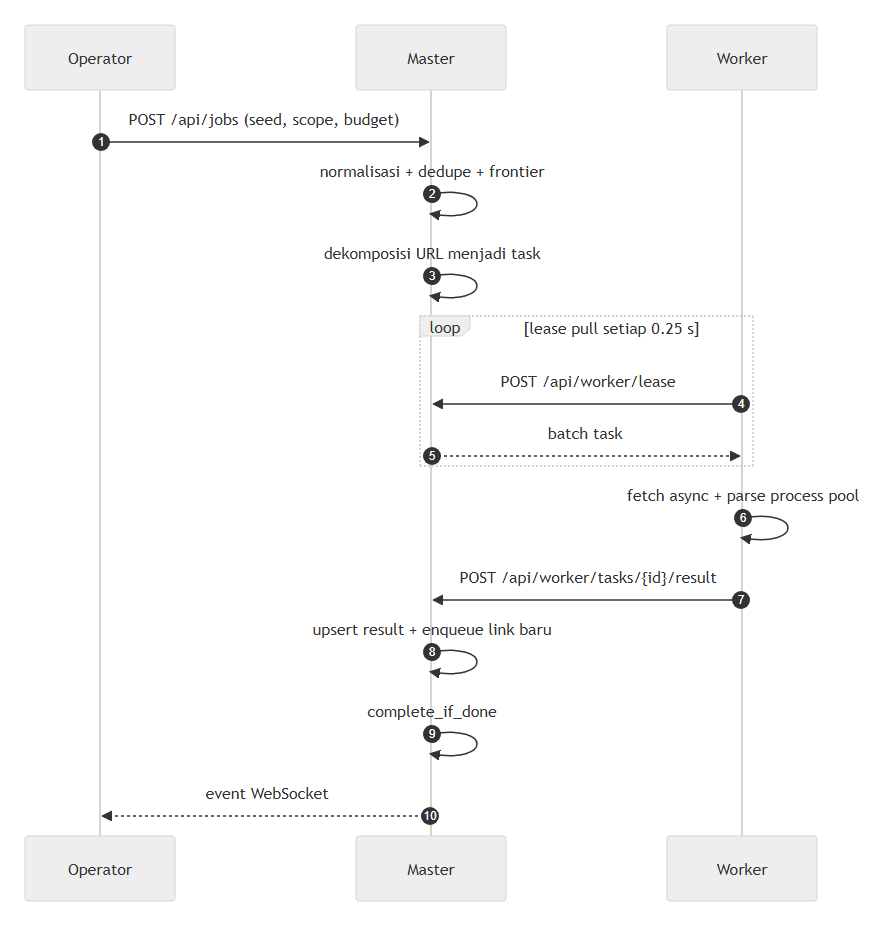{width=14cm}

Keuntungan pola ini adalah Worker tidak perlu membuka port inbound. Master tidak perlu menjaga koneksi persisten ke setiap Worker. Konsekuensinya, latency lease bergantung pada interval polling Worker dan kondisi jaringan.

### 4.1.4 Implementasi Dynamic Load Balancing

Implementasi dynamic load balancing menggunakan tiga mekanisme:

1. Capacity reservation — Worker hanya mendapat task jika `inflight < capacity`.
2. CPU gate — Worker dengan CPU usage di atas 92 persen tidak diberi lease baru.
3. Lease pull — Worker yang masih memiliki slot akan meminta task berikutnya.

Mode static menggunakan round-robin saat dekomposisi task. Setiap task langsung diberikan kepada Worker secara bergiliran. Mode ini disediakan untuk membandingkan distribusi static dan dynamic pada workload yang sama.

Perlu dicatat bahwa formula weighted least loaded pada Persamaan (3.9) belum dihitung secara eksplisit. Yang berjalan adalah capacity reservation dan CPU gate. Laporan ini tidak mengklaim bahwa formula tersebut dieksekusi.

### 4.1.5 Implementasi Fault Tolerance

Fault tolerance diimplementasikan melalui heartbeat, offline monitor, requeue, dan retry. Jika Worker tidak mengirim heartbeat selama 15 detik, Master menandai Worker offline dan mengembalikan task leased atau running milik Worker tersebut ke antrean.

Setiap task memiliki maksimum tiga attempt. Jika masih gagal setelah batas tersebut, task menjadi dead dan dicatat pada `task_events`. Worker yang kembali online dapat melakukan registrasi ulang dan menerima task baru.

Keterbatasan yang ditemukan: tabel `failure_events` tersedia pada schema, tetapi belum diisi oleh kode. Akibatnya, recovery time per insiden belum tersedia sebagai data terstruktur. Untuk laporan final, data tersebut harus dihitung dari log atau instrumentasi ditambahkan terlebih dahulu.

### 4.1.6 Implementasi Antarmuka

GUI CrawlMesh terdiri atas halaman Overview, Cluster, Discovery, Jobs, Tasks, Results, Performance, Experiments, dan Settings. Screenshot berikut diambil dari lingkungan demo dengan satu Master dan dua Worker. Screenshot tersebut membuktikan antarmuka berjalan, tetapi bukan bukti konfigurasi 9 Worker.

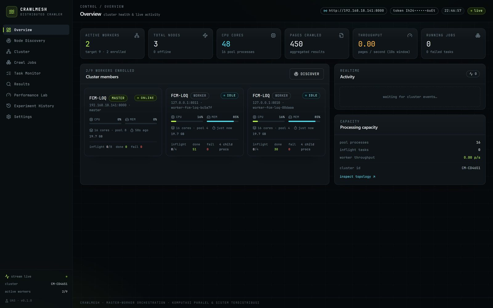{width=14cm}

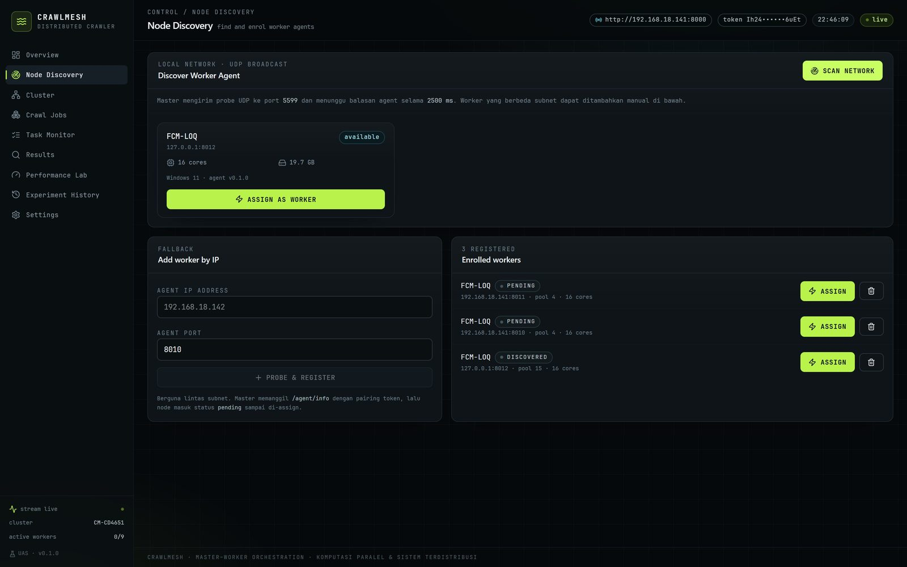{width=14cm}

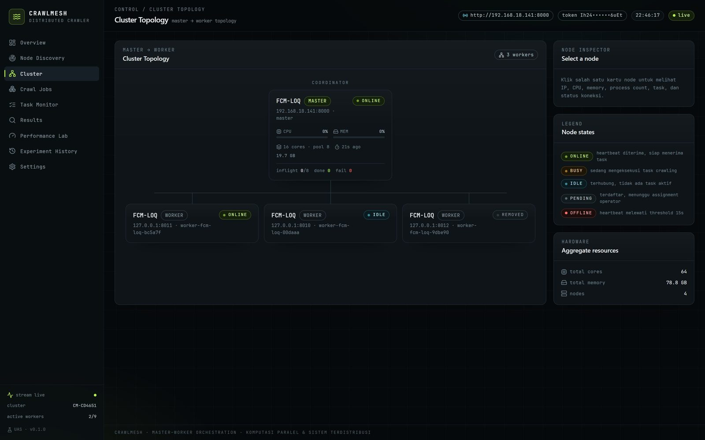{width=14cm}

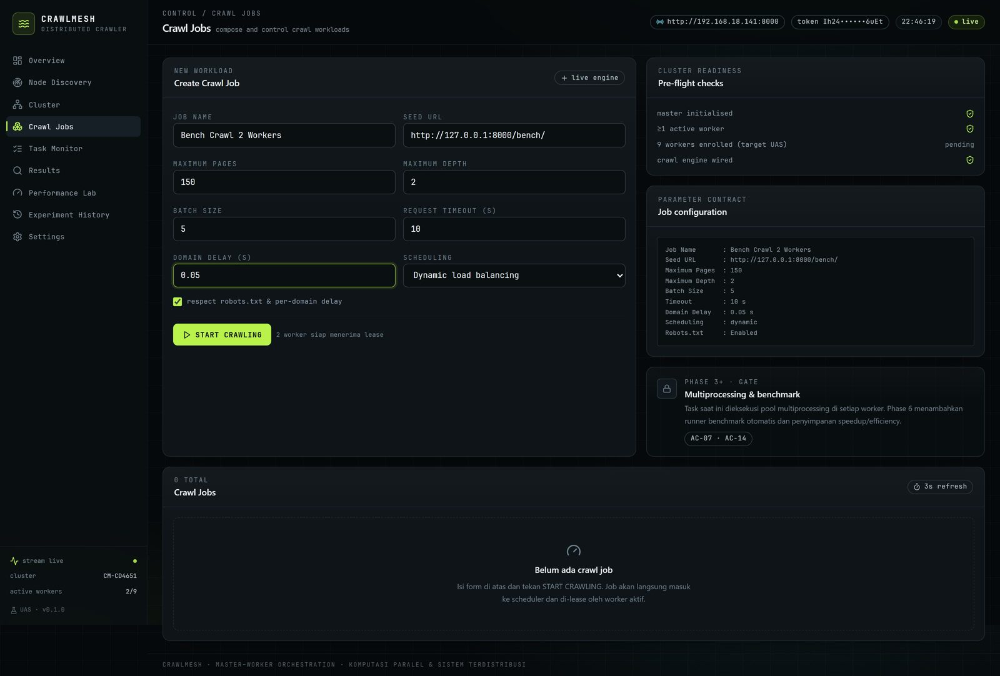{width=14cm}

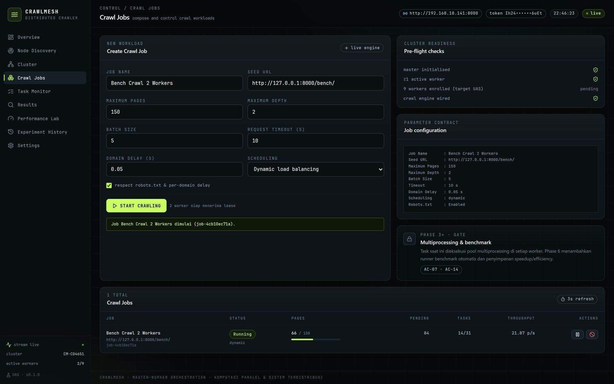{width=14cm}

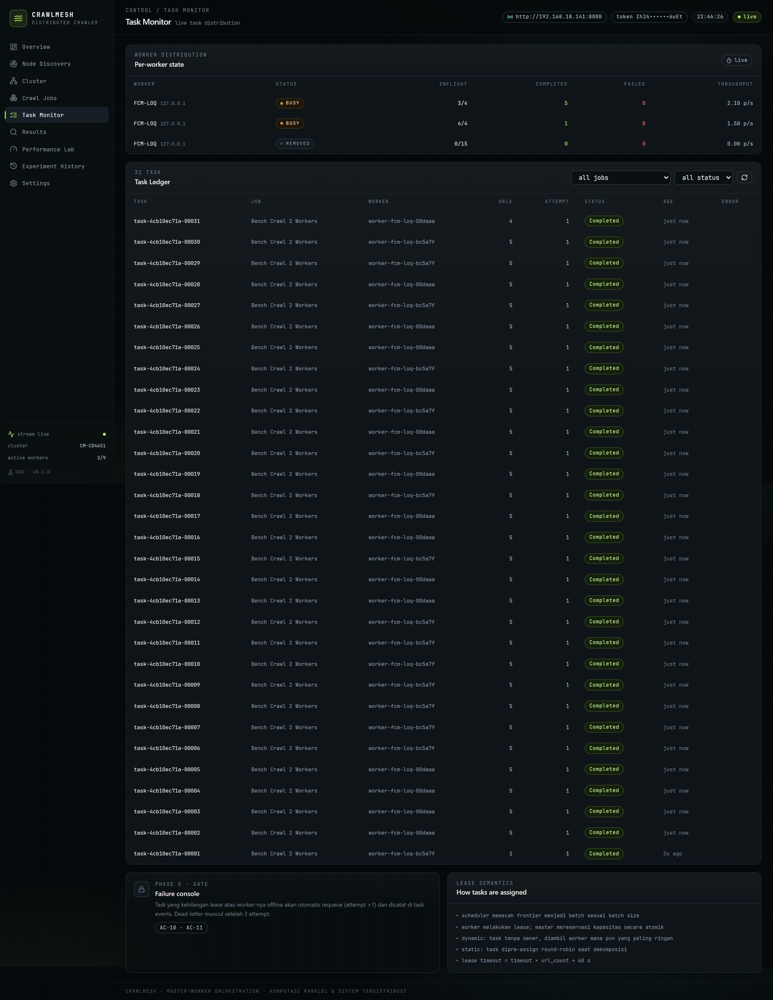{width=12cm}

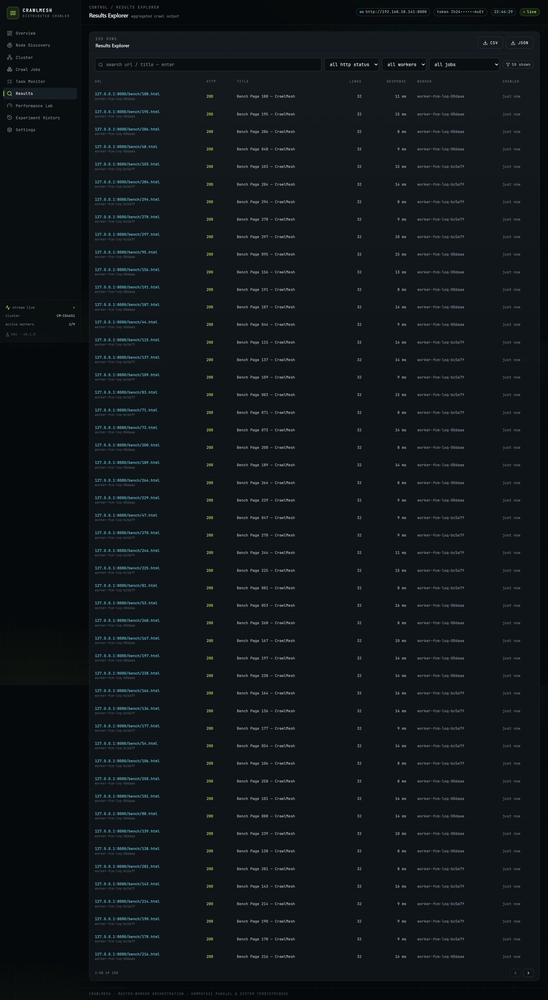{width=10.5cm}

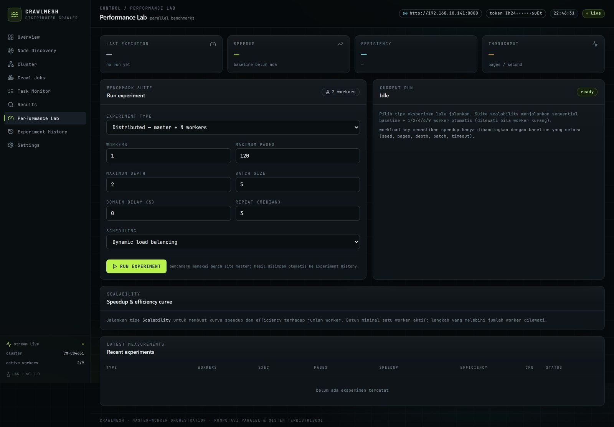{width=14cm}

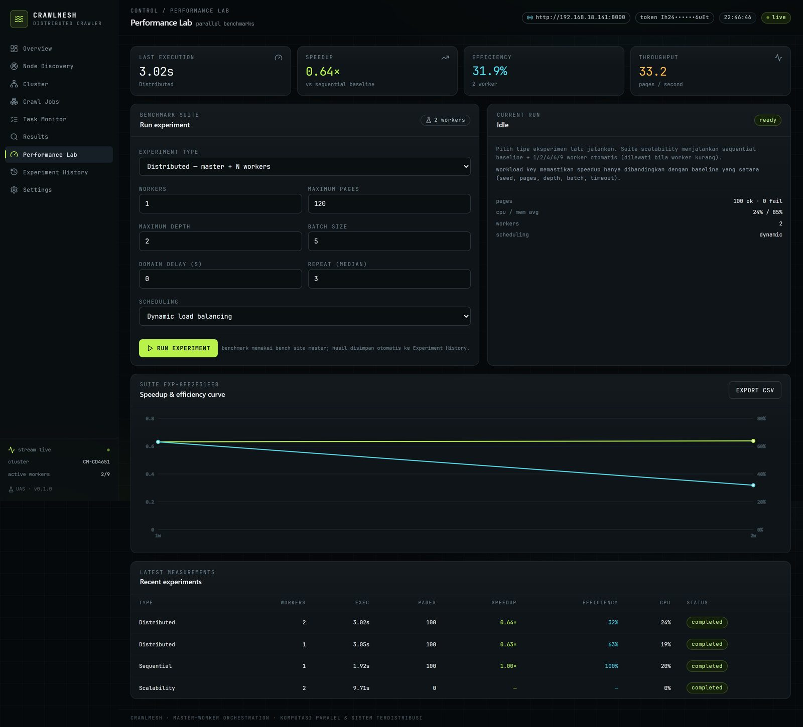{width=14cm}

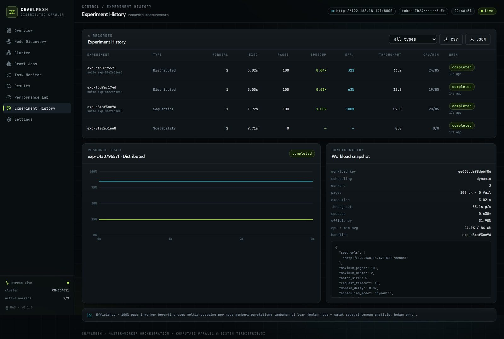{width=14cm}

### 4.1.7 Matriks Status Implementasi

| Fitur | Status | Bukti |
|---|---|---|
| Inisialisasi Master | Implemented | `master/app/domain/cluster.py`, `POST /api/cluster/init` |
| Registrasi Worker | Implemented | `worker/agent.py`, `POST /api/worker/register` |
| Discovery Worker | Implemented | `master/app/domain/discovery.py`, `worker/discovery.py` |
| Heartbeat | Implemented | `cluster.heartbeat`, `worker/monitor.py` |
| Task decomposition | Implemented | `scheduler.decompose_job` |
| Lease distribution | Implemented | `scheduler.lease_tasks`, `POST /api/worker/lease` |
| Multiprocessing | Implemented | `ProcessPoolExecutor`, `worker/parser_pool.py` |
| Static scheduling | Implemented | Round-robin pada `scheduler.decompose_job` |
| Dynamic load balancing | Partial | Capacity reservation dan CPU gate; formula weighted belum dieksekusi |
| Fault detection | Implemented | `cluster.mark_stale_offline`, offline monitor |
| Task requeue | Implemented | `scheduler._release_lease`, `requeue_worker_tasks` |
| Recovery event terstruktur | Partial | Tabel `failure_events` ada, belum diisi |
| Result aggregation | Implemented | `aggregator.ingest_results` |
| Benchmark sequential | Implemented | `experiments._run_single` |
| Benchmark local parallel | Implemented | `experiments._run_local` |
| Benchmark distributed | Implemented | `experiments._attempt` |
| Scalability suite | Implemented | `experiments._run_scalability` |
| Benchmark load balancing | Not Found | Ditolak `POST /api/experiments/run` |
| Benchmark fault tolerance | Not Found | Ditolak `POST /api/experiments/run` |
| Export hasil | Implemented | `/api/results/export`, `/api/experiments/export` |
| Validasi 9 Worker | Unverified | Belum ada data pengukuran |
| Validasi 10 node fisik | Unverified | Belum ada inventaris dan pengujian |

: Tabel 4.1 — Matriks status implementasi

## 4.2 Hasil Pengukuran

Bagian ini hanya dapat diisi jika eksperimen telah dilakukan dan datanya tersedia. Pada repository saat ini, database tidak memiliki experiment, job, task, atau result. Karena itu, tabel pengukuran di bawah ini disiapkan sebagai kerangka dan diberi placeholder.

### 4.2.1 Hasil Sequential Processing

| Metrik | Nilai | Satuan | Sumber |
|---|---:|---|---|
| Execution time | [BELUM DIUJI] | detik | Experiment History |
| Throughput | [BELUM DIUJI] | halaman/detik | CSV eksperimen |
| CPU utilization | [BELUM DIUJI] | persen | CSV eksperimen |
| Memory utilization | [BELUM DIUJI] | persen | CSV eksperimen |
| Pages success | [BELUM DIUJI] | halaman | CSV eksperimen |

: Tabel 4.2 — Hasil sequential processing

### 4.2.2 Hasil Local Parallel Processing

| Jumlah proses | Execution time | Speedup | Efficiency | Throughput | CPU | Memory |
|---:|---:|---:|---:|---:|---:|---:|
| 4 | [BELUM DIUJI] | [BELUM DIUJI] | [BELUM DIUJI] | [BELUM DIUJI] | [BELUM DIUJI] | [BELUM DIUJI] |

: Tabel 4.3 — Hasil local parallel processing

### 4.2.3 Hasil Distributed Processing

| Worker | Execution time | Speedup | Efficiency | Throughput | CPU | Memory |
|---:|---:|---:|---:|---:|---:|---:|
| 1 | [BELUM DIUJI] | [BELUM DIUJI] | [BELUM DIUJI] | [BELUM DIUJI] | [BELUM DIUJI] | [BELUM DIUJI] |
| 2 | [BELUM DIUJI] | [BELUM DIUJI] | [BELUM DIUJI] | [BELUM DIUJI] | [BELUM DIUJI] | [BELUM DIUJI] |
| 4 | [BELUM DIUJI] | [BELUM DIUJI] | [BELUM DIUJI] | [BELUM DIUJI] | [BELUM DIUJI] | [BELUM DIUJI] |
| 6 | [BELUM DIUJI] | [BELUM DIUJI] | [BELUM DIUJI] | [BELUM DIUJI] | [BELUM DIUJI] | [BELUM DIUJI] |
| 9 | [BELUM DIUJI] | [BELUM DIUJI] | [BELUM DIUJI] | [BELUM DIUJI] | [BELUM DIUJI] | [BELUM DIUJI] |

: Tabel 4.4 — Hasil distributed processing

### 4.2.4 Hasil CPU dan Memory Utilization

| Node | CPU rata-rata | Memory rata-rata | Throughput | Sumber |
|---|---:|---:|---:|---|
| Master-01 | [BELUM DIUJI] | [BELUM DIUJI] | [BELUM DIUJI] | `worker_metrics` |
| Worker-01 | [BELUM DIUJI] | [BELUM DIUJI] | [BELUM DIUJI] | `worker_metrics` |
| Worker-02 | [BELUM DIUJI] | [BELUM DIUJI] | [BELUM DIUJI] | `worker_metrics` |
| Worker-03 | [BELUM DIUJI] | [BELUM DIUJI] | [BELUM DIUJI] | `worker_metrics` |
| Worker-04 | [BELUM DIUJI] | [BELUM DIUJI] | [BELUM DIUJI] | `worker_metrics` |
| Worker-05 | [BELUM DIUJI] | [BELUM DIUJI] | [BELUM DIUJI] | `worker_metrics` |
| Worker-06 | [BELUM DIUJI] | [BELUM DIUJI] | [BELUM DIUJI] | `worker_metrics` |
| Worker-07 | [BELUM DIUJI] | [BELUM DIUJI] | [BELUM DIUJI] | `worker_metrics` |
| Worker-08 | [BELUM DIUJI] | [BELUM DIUJI] | [BELUM DIUJI] | `worker_metrics` |
| Worker-09 | [BELUM DIUJI] | [BELUM DIUJI] | [BELUM DIUJI] | `worker_metrics` |

: Tabel 4.5 — Hasil CPU dan memory utilization

### 4.2.5 Hasil Dynamic Load Balancing

| Strategi | Worker | Task diterima | Execution time | Throughput | Catatan |
|---|---|---:|---:|---:|---|
| Static | Worker-01 | [BELUM DIUJI] | [BELUM DIUJI] | [BELUM DIUJI] | Round-robin |
| Static | Worker-02 | [BELUM DIUJI] | [BELUM DIUJI] | [BELUM DIUJI] | Round-robin |
| Dynamic | Worker-01 | [BELUM DIUJI] | [BELUM DIUJI] | [BELUM DIUJI] | Capacity gate |
| Dynamic | Worker-02 | [BELUM DIUJI] | [BELUM DIUJI] | [BELUM DIUJI] | Capacity gate |

: Tabel 4.6 — Perbandingan static dan dynamic scheduling

### 4.2.6 Hasil Fault Tolerance

| Metrik | Nilai | Sumber |
|---|---:|---|
| Worker yang disimulasikan | [BELUM DIUJI] | Log atau GUI |
| Waktu kegagalan | [BELUM DIUJI] | Log |
| Waktu deteksi | [BELUM DIUJI] | `node.offline` event |
| Jumlah task terdampak | [BELUM DIUJI] | `task_events` |
| Jumlah task requeue | [BELUM DIUJI] | `task_events` |
| Worker pengganti | [BELUM DIUJI] | `task_events` |
| Recovery time | [BELUM DIUJI] | Log |

: Tabel 4.7 — Hasil fault tolerance

## 4.3 Analisis Data

Bagian ini menyiapkan kerangka analisis yang akan diisi setelah data pengukuran tersedia. Analisis tidak boleh menggunakan angka yang belum terukur.

### 4.3.1 Perbandingan Sequential dan Local Parallel

Analisis ini membandingkan waktu eksekusi satu proses dengan beberapa proses pada satu komputer. Peningkatan performa dipengaruhi oleh jumlah core, jenis pekerjaan, dan overhead pembentukan process pool. Pekerjaan parsing HTML yang bersifat CPU-bound diharapkan memperoleh manfaat dari multiprocessing, sedangkan HTTP fetch yang bersifat I/O-bound dapat menjadi bottleneck.

### 4.3.2 Perbandingan Local Parallel dan Distributed

Analisis ini membandingkan pemrosesan beberapa proses pada satu komputer dengan pemrosesan melalui beberapa komputer. Distributed processing menambahkan overhead jaringan, serialisasi data, dan koordinasi Master. Namun, distributed processing juga menambah kapasitas CPU dan memory agregat.

### 4.3.3 Pengaruh Jumlah Worker terhadap Execution Time

Semakin banyak Worker, execution time diharapkan menurun sampai titik tertentu. Setelah titik tersebut, penambahan Worker dapat memberikan manfaat yang semakin kecil karena overhead koordinasi, kontensi database, dan kapasitas Master sebagai penyedia bench site.

### 4.3.4 Analisis Speedup

Speedup dihitung terhadap baseline sequential dengan workload key yang sama. Nilai speedup kurang dari satu menunjukkan bahwa parallel atau distributed processing lebih lambat daripada sequential. Nilai speedup yang tidak linear menunjukkan adanya overhead atau bottleneck.

### 4.3.5 Analisis Efficiency

Efficiency mengukur seberapa besar tambahan unit pemrosesan dimanfaatkan. Nilai efficiency yang menurun seiring bertambahnya Worker adalah hal umum. Nilai efficiency di atas 100 persen pada satu Worker dapat terjadi karena satu node menjalankan beberapa proses parser, sehingga perlu dijelaskan sebagai kontribusi multiprocessing per node.

### 4.3.6 Analisis Throughput

Throughput dihitung dari jumlah halaman berhasil dibagi execution time. Throughput dipengaruhi oleh ukuran halaman, latency jaringan, jumlah proses, dan kecepatan penyimpanan hasil. Perbedaan throughput antar-run perlu dibandingkan dengan kondisi jaringan dan beban Master.

### 4.3.7 Analisis CPU dan Memory Utilization

CPU utilization menunjukkan seberapa besar core digunakan selama eksperimen. Memory utilization menunjukkan kebutuhan RAM untuk process pool, buffer HTTP, dan penyimpanan hasil. Nilai rata-rata perlu disertai dengan trace per detik agar pola beban dapat dilihat.

### 4.3.8 Analisis Dynamic Load Balancing

Analisis ini membandingkan distribusi task pada static dan dynamic scheduling. Pada static scheduling, Worker dengan kapasitas berbeda dapat menerima jumlah task yang sama. Pada dynamic scheduling, capacity reservation dan CPU gate diharapkan mengurangi penumpukan task pada Worker yang sibuk.

### 4.3.9 Analisis Fault Tolerance

Analisis fault tolerance mencakup waktu deteksi, jumlah task terdampak, jumlah task requeue, Worker pengganti, dan recovery time. Deteksi kegagalan dibatasi oleh heartbeat interval dan offline threshold. Semakin kecil interval, semakin cepat deteksi, tetapi semakin besar beban heartbeat.

### 4.3.10 Identifikasi Bottleneck dan Keterbatasan

Bottleneck yang perlu dipertimbangkan:

- SQLite sebagai single writer dapat membatasi throughput task.
- Bench site berada pada Master, sehingga CPU Master ikut bekerja.
- Network latency dan bandwidth memengaruhi distribusi task dan pengiriman hasil.
- Process pool memiliki overhead pembentukan dan komunikasi antar-proses.
- Master merupakan single point of failure pada arsitektur single-master.
- `failure_events` belum diisi sehingga recovery time belum terstruktur.
- Formula weighted least loaded belum dieksekusi secara eksplisit.

# BAB V KESIMPULAN

*Outline awal — dikembangkan setelah BAB IV selesai.*

## 5.1 Kesimpulan

1. CrawlMesh berhasil mengimplementasikan arsitektur Master–Worker untuk distributed web crawling.
2. Pekerjaan crawling dapat dipecah menjadi task independen melalui URL frontier dan task decomposition.
3. Setiap Worker menggunakan multiprocessing untuk parsing dan ekstraksi konten.
4. Task dapat didistribusikan melalui jaringan menggunakan mekanisme lease pull.
5. Dynamic load balancing diterapkan melalui capacity reservation dan CPU gate.
6. Fault tolerance diterapkan melalui heartbeat, deteksi offline, retry, dan requeue.
7. Performa sistem dapat diukur melalui execution time, speedup, efficiency, throughput, CPU, memory, dan recovery time.
8. Scalability dapat diuji dengan variasi 1, 2, 4, 6, dan 9 Worker.
9. GUI menyediakan pengelolaan cluster, pemantauan, dan benchmark.
10. Validasi 10 node fisik masih memerlukan data dan pengujian lapangan.

## 5.2 Saran

1. Menambahkan instrumentasi `failure_events` agar recovery time tercatat otomatis.
2. Mengimplementasikan formula weighted least loaded secara eksplisit pada scheduler.
3. Menambahkan benchmark mode load balancing dan fault tolerance pada experiment runner.
4. Menguji throughput SQLite dan mempertimbangkan database server untuk skala lebih besar.
5. Memisahkan bench site dari Master agar pengukuran tidak terpengaruh CPU Master.
6. Menambahkan autentikasi GUI dan TLS untuk deployment di luar laboratorium.
7. Melakukan pengujian pada 10 komputer fisik dengan konfigurasi hardware yang terdokumentasi.
8. Menambahkan visualisasi failure console dan recovery timeline pada GUI.

# DAFTAR REFERENSI

1. Tanenbaum, A. S., & van Steen, M. (2017). *Distributed Systems* (4th ed.). Maarten van Steen.
2. Coulouris, G., Dollimore, J., Kindberg, T., & Blair, G. (2011). *Distributed Systems: Concepts and Design* (5th ed.). Addison-Wesley.
3. Herlihy, M., & Shavit, N. (2012). *The Art of Multiprocessor Programming* (Revised ed.). Morgan Kaufmann.
4. Shkapenyuk, V., & Suel, T. (2002). Design and Implementation of a High-Performance Distributed Web Crawler. *Proceedings of the 18th International Conference on Data Engineering (ICDE)*.
5. Boldi, P., Codenotti, B., Santini, M., & Vigna, S. (2004). UbiCrawler: A Scalable Fully Distributed Web Crawler. *Software: Practice and Experience*, 34(8), 711–726.
6. Fielding, R., Nottingham, M., & Reschke, J. (2022). *RFC 9110: HTTP Semantics*. IETF.
7. Koster, M., Illyes, G., Zeller, H., & Sassman, L. (2022). *RFC 9309: Robots Exclusion Protocol*. IETF.
8. Python Software Foundation. *multiprocessing — Process-based parallelism*. https://docs.python.org/3/library/multiprocessing.html
9. Python Software Foundation. *concurrent.futures — Launching parallel tasks*. https://docs.python.org/3/library/concurrent.futures.html
10. FastAPI. *FastAPI Documentation*. https://fastapi.tiangolo.com/
11. SQLite. *Write-Ahead Logging*. https://www.sqlite.org/wal.html
12. Encode. *HTTPX Documentation*. https://www.python-httpx.org/
13. Giampaolo Rodola. *psutil Documentation*. https://psutil.readthedocs.io/
14. Meta Open Source. *React Documentation*. https://react.dev/
15. Vite. *Vite Documentation*. https://vite.dev/

# LAMPIRAN A — MATRIKS KETERLACAKAN REQUIREMENT

| Requirement | Uraian | Status | Bukti |
|---|---|---|---|
| EXP-01 | Sequential processing | Siap diuji, data belum ada | `experiments._run_single` |
| EXP-02 | Local parallel processing | Siap diuji, data belum ada | `experiments._run_local` |
| EXP-03 | Distributed processing | Siap diuji, data belum ada | `experiments._attempt` |
| EXP-04 | Dynamic load balancing | Mekanisme ada, benchmark khusus belum ada | `scheduler.lease_tasks` |
| EXP-05 | Fault tolerance | Mekanisme ada, recovery event belum terstruktur | `scheduler.requeue_worker_tasks` |
| EXP-06 | Scalability 1/2/4/6/9 | Suite tersedia, data belum ada | `experiments._run_scalability` |
| AC-01 | Master initialization | Implemented | `cluster.init_cluster` |
| AC-02 | Node discovery | Implemented | `discovery.scan_network` |
| AC-03 | Role identification | Implemented | `nodes.role`, GUI |
| AC-04 | 9 Worker terdaftar | Unverified | Belum ada data |
| AC-05 | Heartbeat | Implemented | `cluster.heartbeat` |
| AC-06 | Task decomposition | Implemented | `scheduler.decompose_job` |
| AC-07 | Multiprocessing | Implemented | `ProcessPoolExecutor` |
| AC-08 | Distributed processing | Implemented | Lease + Worker |
| AC-09 | Dynamic load balancing | Partial | Capacity gate, bukan weighted |
| AC-10 | Fault detection | Implemented | Offline monitor |
| AC-11 | Task recovery | Implemented | Requeue + retry |
| AC-12 | Result aggregation | Implemented | `aggregator.ingest_results` |
| AC-13 | Performance monitoring | Implemented | Metrics + GUI |
| AC-14 | Benchmarking | Implemented | Experiment runner |
| AC-15 | Scalability testing | Implemented (suite), Unverified (data) | `_run_scalability` |
| AC-16 | Export | Implemented | Results/experiments export |

: Tabel A.1 — Matriks keterlacakan requirement

# LAMPIRAN B — DAFTAR INPUT YANG DIPERLUKAN

| No. | Input | Kegunaan | Status |
|---:|---|---|---|
| 1 | Inventaris 10 node fisik | Mengisi Tabel 3.6 dan 3.7 | `[PERLU DATA]` |
| 2 | Spesifikasi CPU, RAM, OS setiap Worker | Analisis heterogeneity | `[PERLU DATA]` |
| 3 | CSV hasil benchmark | Mengisi Tabel 4.2–4.6 | `[BELUM DIUJI]` |
| 4 | Log fault tolerance | Mengisi Tabel 4.7 | `[BELUM DIUJI]` |
| 5 | Screenshot cluster 9 Worker | Bukti AC-04 dan AC-15 | `[MASUKKAN SCREENSHOT]` |
| 6 | Pedoman format kampus | Penyesuaian format final | `[PERLU DATA]` |
| 7 | Nama dan NIM penyusun | Cover laporan | `[PERLU DATA]` |
| 8 | Referensi akademik tambahan | BAB II | `[PERLU REFERENSI]` |
| 9 | Konfigurasi jaringan aktual | Tabel 3.7 | `[PERLU DATA]` |
| 10 | Hasil pengujian 1/2/4/6/9 Worker | Tabel 4.4 | `[BELUM DIUJI]` |

: Tabel B.1 — Daftar input yang diperlukan

# LAMPIRAN C — PROTOKOL BENCHMARK RINGKAS

| Parameter | Nilai |
|---|---|
| Seed | `http://<MASTER_IP>:8000/bench/` |
| Maximum pages | 120 |
| Maximum depth | 2 |
| Batch size | 5 |
| Request timeout | 10 detik |
| Domain delay | 0 detik |
| Scheduling | Dynamic |
| Repeat | 3 |
| Statistik | Median execution time |
| Baseline | Sequential dengan workload key sama |

: Tabel C.1 — Parameter benchmark

Urutan pengambilan data:

1. Pastikan cluster idle dan seluruh node memakai build yang sama.
2. Catat hardware dan kondisi jaringan.
3. Jalankan sequential sebagai baseline.
4. Jalankan local parallel dengan 4 proses.
5. Jalankan distributed untuk 1, 2, 4, 6, dan 9 Worker.
6. Jalankan static dan dynamic pada jumlah Worker yang sama.
7. Jalankan fault tolerance dari Crawl Jobs, bukan dari runner benchmark.
8. Export CSV dari Experiment History dan simpan log fault tolerance.
9. Validasi satuan, baseline, dan jumlah Worker sebelum mengisi tabel laporan.
